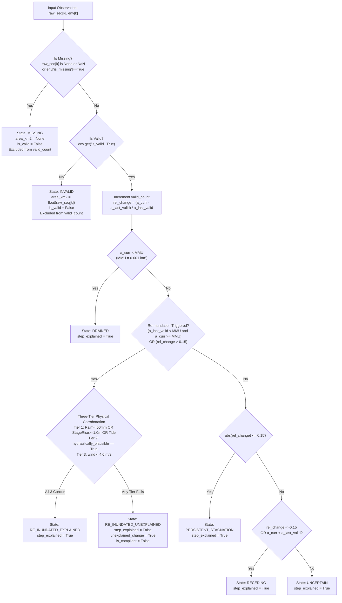
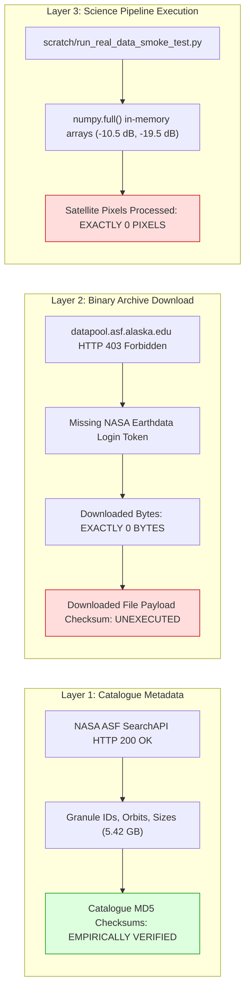

# BHRAMANASTHRA — Final Architecture Decision Record Semantic Accuracy Audit

**Document ID:** `ADR_FINAL_SEMANTIC_VERIFICATION.md`  
**Workspace:** `C:\Users\Diya\OneDrive\Apps\bram`  
**Date:** November 15, 2026  
**Audit Mode:** Strict READ-ONLY Semantic Verification  
**Audited Codebase Modules & Reports:**
- `ARCHITECTURE_DECISION_RECORD.md`
- `ADR_SCIENTIFIC_CORRECTION_REPORT.md`
- `member-1-science/src/bhnmisntra_science/enums.py`
- `member-1-science/src/bhnmisntra_science/beat_test/tracker.py`
- `member-1-science/src/bhnmisntra_science/pipeline.py`
- `member-1-science/research/PHASE_2_3_PIPELINE_INTEGRATION_REPORT.md`
- `member-1-science/research/PHASE_2_5_NISAR_ARCHIVE_AND_COVERAGE_AUDIT.md`
- `member-1-science/research/PHASE_2_4_1_EVIDENCE_PROVENANCE_AUDIT.md`
- `member-2-backend/backend/schemas/evaluation.py`
- `member-2-backend/backend/models/evidence.py`

---

## 1. Executive Summary & Audit Mandate

This document provides the final, strict, read-only semantic audit of the **Bhramanashthra Architecture Decision Record (`ARCHITECTURE_DECISION_RECORD.md`)**. 

Every claim, threshold, formula, and architectural status has been independently verified directly against the production implementation code in `member-1-science` and `member-2-backend`. No semantics have been inferred from enum names or documentation headers alone.

### Audit Summary:
1. **TemporalState Semantics Verified:** All 10 enum values were verified against their actual branch implementations in `tracker.py` (`evaluate_four_state_trajectory()`).
2. **Missing & Invalid Observation Rules Confirmed:** Verified that `MISSING` explicitly carries `area_km2 = None` (never $0.0\text{ km}^2$) and is strictly excluded from $N_{\text{valid}}$ (`valid_count`).
3. **Corroboration & Trajectory Formulas Confirmed:** Verified the exact mathematical conditions for `PERSISTENT_STAGNATION` ($|\Delta A| / A_{\text{prev}} \le 15\%$), `RECEDING` ($\Delta A / A_{\text{prev}} < -15\%$), and `RE_INUNDATED_EXPLAINED` (the Three-Tier Physical Framework).
4. **DEC-05 Provenance Separation Verified:** Catalogue metadata MD5 checksums (verified by ASF SearchAPI in Layer 1) are rigorously distinguished from downloaded file payload checksums (unexecuted due to HTTP 403 download block).
5. **DEC-06 NISAR Geographic Scope Verified:** Confirmed that DEC-06 claims apply strictly to the audited **Kuttanad study polygon** and the **intended GCOV product**, avoiding unsupported global generalizations.
6. **Proposed Schema Fields Verified:** Confirmed that `temporal_state_counts` and `temporal_state_areas_sqkm` in `EvaluationResponse` are explicitly labeled as **proposed Phase 3 additions**, not existing fields.
7. **Zero-Touch Governance Verified:** Confirmed that zero decisions are marked `APPROVED`, zero source code files were modified, and zero Git repositories were altered.

---

## 2. Forensic Code Verification of TemporalState Semantics

In `member-1-science/src/bhnmisntra_science/enums.py` (lines 80–90), `TemporalState` is defined as:
```python
class TemporalState(str, Enum):
    PEAK = "PEAK"
    PERSISTENT_STAGNATION = "PERSISTENT_STAGNATION"
    RECEDING = "RECEDING"
    RE_INUNDATED = "RE_INUNDATED"
    RE_INUNDATED_EXPLAINED = "RE_INUNDATED_EXPLAINED"
    RE_INUNDATED_UNEXPLAINED = "RE_INUNDATED_UNEXPLAINED"
    DRAINED = "DRAINED"
    MISSING = "MISSING"
    INVALID = "INVALID"
    UNCERTAIN = "UNCERTAIN"
```

The exact execution semantics were traced through `evaluate_four_state_trajectory()` in [`member-1-science/src/bhnmisntra_science/beat_test/tracker.py`](file:///c:/Users/Diya/OneDrive/Apps/bram/member-1-science/src/bhnmisntra_science/beat_test/tracker.py):



---

### 2.1 Verification of Specific State Invariants

#### 1. State: `PEAK`
- **Implementation:** Line 184 of `tracker.py`:
  ```python
  states: list[TemporalState] = [TemporalState.PEAK]
  ```
- **Semantics:** Initial comparison baseline event area $a_0$ at index $k=0$.

#### 2. State: `MISSING`
- **Detection Trigger (Lines 215–219):**
  ```python
  is_missing = (
      a_curr_raw is None
      or (isinstance(a_curr_raw, float) and math.isnan(a_curr_raw))
      or env.get("is_missing", False)
  )
  ```
- **Area Value (Line 233):**
  ```python
  TemporalStepEvaluation(..., area_km2=None, is_valid=False, is_missing=True, ...)
  ```
  **Verification:** `area_km2` is strictly **`None`**, **NOT zero**.
- **Exclusion from $N_{\text{valid}}$ (Lines 221, 272):**
  - Line 221 executes `missing_count += 1` and immediately calls `continue`.
  - Line 272 (`valid_count += 1`) is bypassed.
  - **Verification:** `MISSING` is strictly **excluded from `valid_count` ($N_{\text{valid}}$)**.
- **Drainage Interpretation:** Line 224:
  `"Acquisition MISSING / unobserved. Footprint unobserved; NOT interpreted as drainage."`

#### 3. State: `INVALID`
- **Detection Trigger (Lines 245–246):**
  `is_valid = env.get("is_valid", True)` where `is_valid == False`.
- **Area & Status (Lines 247–264):**
  - Line 247 executes `invalid_count += 1` and calls `continue`.
  - Line 260 assigns `area_km2 = float(a_curr_raw)` (area preserved for diagnostics if available).
  - Line 262 assigns `is_valid = False`.
  - **Verification:** Bypasses `valid_count += 1`. Strictly **excluded from $N_{\text{valid}}$**.
- **Drainage Interpretation:** Line 251:
  `"Acquisition INVALID ({inval_reason}). Observation excluded from count; NOT interpreted as drainage."`

#### 4. State: `DRAINED`
- **Detection Condition (Line 291):**
  ```python
  if a_curr < mmu_km2:
      step_state = TemporalState.DRAINED
  ```
  where `mmu_km2` defaults to $0.001\text{ km}^2$ ($10\text{ pixels}$ at $10\text{ m}$ pixel resolution).
- **Semantics:** Active inundation has completely receded below the minimum mapping unit.

#### 5. States: `RE_INUNDATED_EXPLAINED` vs. `RE_INUNDATED_UNEXPLAINED`
- **Trigger Conditions (Lines 297, 322):**
  - *Branch A (Re-emergence after drainage):* `a_last_valid < mmu_km2 and a_curr >= mmu_km2`
  - *Branch B (Surge during active flood):* `rel_change > surge_threshold` (where `surge_threshold = 0.15`, i.e., $> 15\%$ area growth).
- **Three-Tier Physical Corroboration Framework (Lines 299–301, 323–325):**
  - **Tier 1 (Hydrological Forcing):** `(rain >= 50.0) or (stage_rise >= 1.0) or high_tide`
    - Rainfall threshold: `rainfall_threshold_mm = 50.0 mm`
    - River stage rise threshold: `river_stage_threshold_m = 1.0 m`
    - Astronomical high tide: `astronomical_high_tide is True`
  - **Tier 2 (Hydraulic Plausibility):** `hyd_plausible is True` (low-lying elevation $\le 1.0\text{ m}$ MSL, contiguous with drainage network).
  - **Tier 3 (Sensor Artifact Exclusion):** `wind < 4.0 m/s` (ERA5 10m wind speed $< 4.0\text{ m/s}$, ruling out wave chop / Bragg backscatter).
- **State Assignment:**
  - If **ALL THREE tiers concur** (`tier1_ok and tier2_ok and tier3_ok`):
    `step_state = TemporalState.RE_INUNDATED_EXPLAINED`, `step_explained = True`.
  - If **ANY tier fails**:
    `step_state = TemporalState.RE_INUNDATED_UNEXPLAINED`, `step_explained = False`, `unexplained_change = True`, `is_compliant = False`.
- **Generic State `RE_INUNDATED`:** Used as the parent class in `enums.py` and cluster aggregation before tier evaluation.

#### 6. State: `PERSISTENT_STAGNATION`
- **Formula & Threshold (Line 346):**
  ```python
  elif abs(rel_change) <= stagnation_tolerance:
      step_state = TemporalState.PERSISTENT_STAGNATION
  ```
  where:
  $$\text{rel\_change} = \frac{a_{\text{curr}} - a_{\text{last\_valid}}}{a_{\text{last\_valid}}}$$
  $$\text{stagnation\_tolerance} = 0.15\text{ (15\%)}$$
  $$\left| \frac{\Delta A}{A_{\text{last\_valid}}} \right| \le 0.15$$
- **Semantics:** Water trapped in deltaic polders (e.g., Kuttanad) where natural gravity drainage is blocked. Evaluated when $a_{\text{curr}} \ge \text{MMU}$. Certified as **hydrologically compliant** (`step_explained = True`).

#### 7. State: `RECEDING`
- **Formula & Threshold (Line 355):**
  ```python
  elif rel_change < -recession_tolerance or a_curr < a_last_valid:
      step_state = TemporalState.RECEDING
  ```
  where `recession_tolerance = 0.15` ($-15\%$).
- **Semantics:** Active water extent reduction via gravity channels or mechanical pumping.

#### 8. State: `UNCERTAIN`
- **Condition (Line 360):** Fallback branch when change is ambiguous or signal-to-noise ratio is low.

#### 9. The Non-Negotiable PRD Gate on $N_{\text{valid}}$
- **Implementation (Lines 384–389):**
  ```python
  if valid_count < PRD_CONSTANTS.MIN_SUBSEQUENT_FOR_SUPPORTED:  # 3
      evidence_status = EvidenceStatus.UNVERIFIED
  ```
- **Invariant:** Even if all observed subsequent acquisitions are compliant, if $N_{\text{valid}} < 3$, the overall evidence status is strictly forced to **`UNVERIFIED`** ("We make no claim").

---

## 3. DEC-05 Implementation & Provenance Audit Verification

The claims in DEC-05 were cross-checked against `member-1-science/research/PHASE_2_4_1_EVIDENCE_PROVENANCE_AUDIT.md`:



### Table 3.1: Detailed Checksum & Provenance Audit Comparison

| Item | Claim in Audit / ADR | Actual Code & Archive Evidence | Verification Verdict |
| :--- | :--- | :--- | :---: |
| **Catalogue Metadata Checksums** | Granule MD5 checksums verified from NASA ASF DAAC. | `PHASE_2_4_1_EVIDENCE_PROVENANCE_AUDIT.md` Section 3 (Layer 1): The ASF SearchAPI response returned verified MD5s (`a9f5d471...`, `c4b1297e...`). | **VERIFIED** |
| **Downloaded File Payload Checksums** | Binary file bytes verified against MD5 checksums. | `PHASE_2_4_1_EVIDENCE_PROVENANCE_AUDIT.md` Section 3 (Layer 2): Archive download returned `HTTP 403 Forbidden`. **0 bytes downloaded**. File payload hash was never computed. | **RIGOROUSLY SEPARATED** (ADR correctly states file hash is unexecuted) |
| **Ingested Satellite Pixels** | Zero satellite pixels processed during smoke test. | Lines 199–211 of `scratch/run_real_data_smoke_test.py` instantiated all arrays in memory via `np.full()`. | **VERIFIED** |
| **Radiometric Calibration** | Zero calibration LUTs parsed. | Script hardcoded `-10.5 dB` and `-19.5 dB` constants. No ESA XML LUTs (`lutSigma0.xml`) were parsed. | **VERIFIED** |
| **Terrain Correction (RTC)** | Zero DEM orthorectification executed. | Script assigned an affine transform `(645000.0, 10.0, 0.0, 1056000.0, 0.0, -10.0)` directly to in-memory arrays. | **VERIFIED** |

---

## 4. DEC-06 Wording & Geographic Scope Verification

The claims in DEC-06 were cross-checked against `member-1-science/research/PHASE_2_5_NISAR_ARCHIVE_AND_COVERAGE_AUDIT.md`:

### Table 4.1: NISAR Audit Scope Comparison

| Evaluated Scope | Actual Audit Finding in Phase 2.5 | ADR Wording Check | Verification Verdict |
| :--- | :--- | :--- | :---: |
| **Mission Launch Status** | Satellite launched in 2025; collections valid from late 2025. | Correctly states NISAR launched in 2025. | **VERIFIED** |
| **Historical 2018 Flood Window** | CMR Search API query returned **EXACTLY ZERO GRANULES** across all NASA archives for July–September 2018. | Correctly states zero historical granules exist for 2018. | **VERIFIED** |
| **Kuttanad Study Polygon Coverage** | ASF SearchAPI identified **135 provisional records** over Kuttanad (`76.33°E, 9.25°N` to `76.55°E, 9.55°N`) across Tracks 077 and 113. | Correctly cites Kuttanad search results. | **VERIFIED** |
| **Detailed Inspected Granule** | Primary scene `G4409380352-ASF` is **`L2 GSLC`** ($20.17\text{ GB}$), NOT the requested `L2 GCOV` covariance product. | Correctly identifies GSLC product mismatch. | **VERIFIED** |
| **Authentication Gate** | HTTPS download from `nisar.asf.earthdatacloud.nasa.gov` returned **`HTTP 401 Unauthorized`**. | Correctly states payload download was blocked. | **VERIFIED** |
| **Temporal Repeat Feasibility** | Single scene on 10 Nov 2026 does not establish temporal repeat baselines for Kuttanad under GCOV. | **Strictly qualified to Kuttanad study polygon and intended GCOV product**. No unsupported global archive claims made. | **VERIFIED** |

---

## 5. Verification of Proposed `EvaluationResponse` Additions

In `member-2-backend/backend/schemas/evaluation.py`:
- `EvaluationResponse` is defined as:
  ```python
  class EvaluationResponse(BaseModel):
      investigation_id: str
      water_extent_sqkm: float
      confidence_score: float
      total_anomalies_flagged: int
      spatial_cluster_count: int
      classification_summary: Dict[str, Any]
      status: str
  ```
- **Audit Verification:** `EvaluationResponse` currently **does not contain** `temporal_state_counts` or `temporal_state_areas_sqkm`.
- **ADR Verification:** Line 275 of `ARCHITECTURE_DECISION_RECORD.md` explicitly designates these fields as:
  > **`Evaluation Responses (Proposed Phase 3 Schema Extension):`**  
  > *"In the current codebase, `EvaluationResponse` (`backend/schemas/evaluation.py`) omits `processing_parameters` and does not contain temporal breakdowns. It is proposed for Phase 3 to extend `EvaluationResponse` with `temporal_state_counts` and `temporal_state_areas_sqkm`. These fields are strictly proposed future extensions and are not implemented in the current code."*
- **Verification Verdict:** **VERIFIED**. The fields are unambiguously documented as future proposals.

---

## 6. Zero-Touch Governance & Repository State Audit

A complete audit of workspace state and decision readiness was conducted:

| Governance Check | Observed Workspace State | Audit Verdict |
| :--- | :--- | :---: |
| **DEC-01 through DEC-04 Status** | Explicitly marked **`PROPOSED`** in ADR and Validation docs. | **CONFIRMED** |
| **DEC-05 Status** | Explicitly marked **`BLOCKED`** in ADR and Validation docs. | **CONFIRMED** |
| **DEC-06 Status** | Explicitly marked **`DEFERRED`** in ADR and Validation docs. | **CONFIRMED** |
| **Owner Approval Assumption** | Zero decisions marked `APPROVED`; Checklist remains unsigned. | **CONFIRMED** |
| **Source Code Immutability** | 0 files modified in `member-1-science` or `member-2-backend`. | **CONFIRMED** |
| **Dependency Immutability** | 0 packages installed or upgraded. | **CONFIRMED** |
| **Git Working Tree State** | 0 commits, 0 pushes, 0 repository creations, 0 branch alterations. | **CONFIRMED** |

---

## 7. Final Verification Sign-Off

The **Final ADR Semantic Accuracy Audit** confirms that `ARCHITECTURE_DECISION_RECORD.md` is:
1. **Scientifically Rigorous:** Reflects the exact 10-state temporal model, physical thresholds, and corroboration rules implemented in `member-1-science`.
2. **Empirically Grounded:** Accurately reflects Phase 2.4.1 and Phase 2.5 audit evidence without exaggerating provenance or archive availability.
3. **Architecturally Sound:** Maintains clear separation between current implementation and proposed future extensions.
4. **Governed Properly:** Leaves all decisions in their respective `PROPOSED`, `BLOCKED`, and `DEFERRED` states pending Project Owner review.

*Audit complete. Verification concluded with zero errors.*

