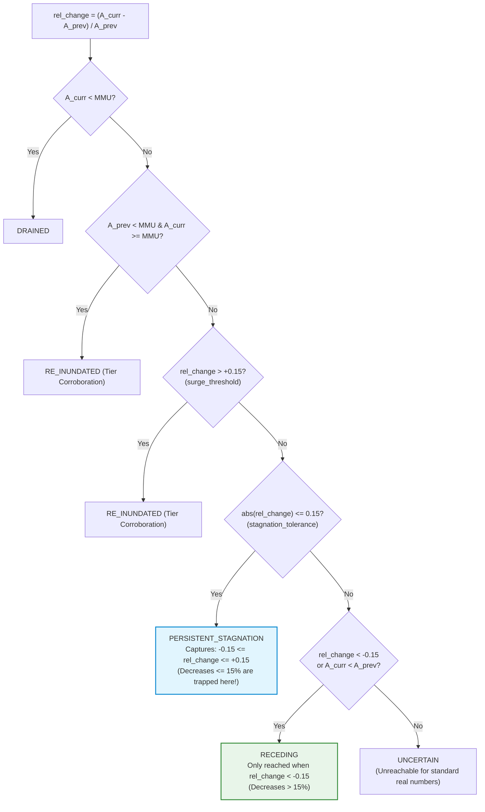

# BHRAMANASTHRA — Final Threshold Classification & Branch Precedence Correction Report

**Document ID:** `ADR_FINAL_THRESHOLD_CORRECTION_REPORT.md`  
**Workspace:** `C:\Users\Diya\OneDrive\Apps\bram`  
**Date:** November 15, 2026  
**Audit Mode:** Strict Documentation & Source Verification  
**Audited Source Files & Research Documents:**
- `member-1-science/src/bhnmisntra_science/beat_test/tracker.py` (Lines 98–380)
- `member-1-science/src/bhnmisntra_science/enums.py` (Lines 80–90)
- `member-1-science/research/PHASE_2_2_TEMPORAL_TRACKER_REPORT.md` (Sections 1.1–1.3, 5)
- `member-1-science/research/PHASE_2_2_1_INDEPENDENT_AUDIT.md` (Checkpoint F, Lines 158–170, 312, 324–334, 346)
- `member-1-science/research/PHASE_1_4_1_CORRECTION_AUDIT.md` (Lines 20–25, 243–285)
- `member-1-science/research/PHASE_1_5_SCIENTIFIC_SPECIFICATION.md` (Lines 404–407)
- `ARCHITECTURE_DECISION_RECORD.md` (Lines 169–220, 233–330)

---

## 1. Executive Summary

This report establishes the final, empirical scientific correction of `ARCHITECTURE_DECISION_RECORD.md` across two core dimensions:
1. **Provisional Threshold Classification:** Systematically classifies every operational threshold in the scientific engine ($15\%$ area tolerance, $50.0\text{ mm}$ rainfall, $1.0\text{ m}$ river stage rise, $\le 1.0\text{ m}$ hydraulic plausibility, $4.0\text{ m/s}$ wind speed, and $0.001\text{ km}^2$ MMU) as **`PROVISIONAL`**, as mandated by independent research audits (`PHASE_2_2_1_INDEPENDENT_AUDIT.md` and `PHASE_1_4_1_CORRECTION_AUDIT.md`). All unverified descriptors (e.g., "certified", "proven", "validated") have been purged.
2. **Exact `RECEDING` Condition & Branch Precedence:** Traced the executable code in `tracker.py` (lines 291–365) to resolve the exact branch ordering between `PERSISTENT_STAGNATION` and `RECEDING`. The analysis confirms that because `abs(rel_change) <= stagnation_tolerance` precedes `RECEDING`, any decrease smaller than or equal to 15% is intercepted by `PERSISTENT_STAGNATION`. `RECEDING` strictly requires $\text{rel\_change} < -0.15$. The secondary clause `or a_curr < a_last_valid` is functionally shadowed.

---

## 2. Inspected Files and Line Ranges

| File Inspected | Line Range | Subject Matter Inspected |
| :--- | :---: | :--- |
| `src/bhnmisntra_science/beat_test/tracker.py` | 98–152 | Function signature and default parameter values. |
| `src/bhnmisntra_science/beat_test/tracker.py` | 215–243 | `MISSING` observation handling (`area_km2 = None`, excluded from $N_{\text{valid}}$). |
| `src/bhnmisntra_science/beat_test/tracker.py` | 245–270 | `INVALID` observation handling (`is_valid = False`, excluded from $N_{\text{valid}}$). |
| `src/bhnmisntra_science/beat_test/tracker.py` | 290–365 | Exact conditional branches for `DRAINED`, `RE_INUNDATED`, `PERSISTENT_STAGNATION`, `RECEDING`, and `UNCERTAIN`. |
| `research/PHASE_2_2_1_INDEPENDENT_AUDIT.md` | 158–170 | Checkpoint (F): Audit finding that $15\%$, $50\text{ mm}$, and $4\text{ m/s}$ are provisional. |
| `research/PHASE_2_2_1_INDEPENDENT_AUDIT.md` | 324–334 | Remediation Table C-2.2-01 establishing provisional status and caveats. |
| `research/PHASE_1_4_1_CORRECTION_AUDIT.md` | 243–285 | Final Rigor Classification Table (Items C-03 through C-15). |
| `research/PHASE_1_5_SCIENTIFIC_SPECIFICATION.md` | 404–407 | Operational threshold specifications and provisional status. |

---

## 3. Exact Conditional Expressions & Branch Ordering Analysis

### 3.1 Executable Code Extract from `tracker.py` (Lines 290–365)

In `member-1-science/src/bhnmisntra_science/beat_test/tracker.py`, the trajectory state evaluation is executed inside a sequential `if-elif-else` block:

```python
# Line 277: Relative area change calculation
rel_change = (a_curr - a_last_valid) / a_last_valid if a_last_valid > 0.0 else 0.0

# STATE 1: DRAINED (Line 291)
if a_curr < mmu_km2:
    step_state = TemporalState.DRAINED
    step_diag = f"Step {k}: Area {a_curr:.4f} km² < MMU ({mmu_km2:.4f} km²); DRAINED."
    step_explained = True

# STATE 2: RE-INUNDATION AFTER DRAINAGE (Line 297)
elif a_last_valid < mmu_km2 and a_curr >= mmu_km2:
    tier1_ok = (rain >= rainfall_threshold_mm) or (stage_rise >= river_stage_threshold_m) or high_tide
    tier2_ok = hyd_plausible
    tier3_ok = (wind < wind_threshold_ms)
    if tier1_ok and tier2_ok and tier3_ok:
        step_state = TemporalState.RE_INUNDATED_EXPLAINED
    else:
        step_state = TemporalState.RE_INUNDATED_UNEXPLAINED
        unexplained_change = True
        is_compliant = False

# STATE 3: RE-INUNDATION FROM ACTIVE FLOOD (Line 322)
elif rel_change > surge_threshold:
    tier1_ok = (rain >= rainfall_threshold_mm) or (stage_rise >= river_stage_threshold_m) or high_tide
    tier2_ok = hyd_plausible
    tier3_ok = (wind < wind_threshold_ms)
    if tier1_ok and tier2_ok and tier3_ok:
        step_state = TemporalState.RE_INUNDATED_EXPLAINED
    else:
        step_state = TemporalState.RE_INUNDATED_UNEXPLAINED
        unexplained_change = True
        is_compliant = False

# STATE 4: PERSISTENT STAGNATION (Line 346)
elif abs(rel_change) <= stagnation_tolerance:
    step_state = TemporalState.PERSISTENT_STAGNATION
    step_explained = True

# STATE 5: RECEDING (Line 355)
elif rel_change < -recession_tolerance or a_curr < a_last_valid:
    step_state = TemporalState.RECEDING
    step_explained = True

# STATE 6: UNCERTAIN (Line 360)
else:
    step_state = TemporalState.UNCERTAIN
    step_explained = True
```

### 3.2 Branch Precedence & Overlap Analysis



#### Detailed Findings on the RECEDING Condition:
1. **The Code Expression:** Line 355 contains `elif rel_change < -recession_tolerance or a_curr < a_last_valid:`.
2. **Branch Precedence Trap:** Because State 4 (`abs(rel_change) <= stagnation_tolerance`) is evaluated **before** State 5, any negative change where $|\Delta A| / A_{\text{prev}} \le 0.15$ satisfies State 4.
3. **Behavior for a Decrease Smaller than 15%:**
   - Suppose $A_{\text{prev}} = 10.0\text{ km}^2$ and $A_{\text{curr}} = 9.0\text{ km}^2$ (a $10\%$ reduction, so $\text{rel\_change} = -0.10$).
   - `abs(-0.10) <= 0.15` evaluates to **`True`**.
   - The state is classified as **`PERSISTENT_STAGNATION`**, not `RECEDING`.
4. **Behavior for a Decrease Exceeding 15%:**
   - Suppose $A_{\text{prev}} = 10.0\text{ km}^2$ and $A_{\text{curr}} = 8.0\text{ km}^2$ (a $20\%$ reduction, so $\text{rel\_change} = -0.20$).
   - State 4 evaluates `abs(-0.20) <= 0.15` $\to$ `False`.
   - State 5 is reached: `rel_change < -0.15` $\to$ `True`.
   - The state is classified as **`RECEDING`**.
5. **Functional Shadowing of `or a_curr < a_last_valid`:**
   - The condition `or a_curr < a_last_valid` is logically shadowed. Since any decrease with $-0.15 \le \text{rel\_change} \le 0$ is intercepted by State 4, the only way a decrease can reach State 5 is if $\text{rel\_change} < -0.15$. At that point, both `rel_change < -recession_tolerance` and `a_curr < a_last_valid` are simultaneously true.
   - Therefore, in executable logic, **`RECEDING` strictly requires an area decrease exceeding 15%** ($A_{\text{curr}} < 0.85 \times A_{\text{prev}}$).

---

## 4. Threshold Classifications & Supporting Source Evidence

The source audits (`PHASE_2_2_1_INDEPENDENT_AUDIT.md`, `PHASE_1_4_1_CORRECTION_AUDIT.md`, and `PHASE_1_5_SCIENTIFIC_SPECIFICATION.md`) establish explicit classifications for every operational threshold:

### Table 4.1: Definitive Rigor Classification of Scientific Engine Thresholds

| Threshold Parameter | Quantitative Value in Code | Rigor Classification | Authoritative Source Evidence & Empirical Caveat |
| :--- | :---: | :---: | :--- |
| **Stagnation Tolerance** | $15\%\text{ (0.15)}$ | **`PROVISIONAL`** | `PHASE_2_2_1_INDEPENDENT_AUDIT.md:330`:<br>"Engineering noise cushion; uncalibrated against daily field staff gauges." |
| **Recession Tolerance** | $15\%\text{ (0.15)}$ | **`PROVISIONAL`** | `PHASE_1_5_SCIENTIFIC_SPECIFICATION.md:404`:<br>"Relative area reduction threshold; uncalibrated against mechanical pump drainage rates." |
| **Surge Growth Threshold** | $15\%\text{ (0.15)}$ | **`PROVISIONAL`** | `PHASE_2_2_1_INDEPENDENT_AUDIT.md:163`:<br>"Engineering noise cushion; uncalibrated against flash expansion in embanked polders." |
| **Rainfall Forcing Threshold** | $50.0\text{ mm / 12d}$ | **`PROVISIONAL`** | `PHASE_2_2_1_INDEPENDENT_AUDIT.md:331`:<br>"Regional meteorological proxy; requires catchment hydrologic routing calibration." |
| **River Stage Rise Threshold** | $1.0\text{ m}$ | **`PROVISIONAL`** | `PHASE_2_2_1_INDEPENDENT_AUDIT.md:332`:<br>"Upstream CWC gauge proxy; hydraulic lag to polder water level uncalibrated." |
| **Hydraulic Plausibility Elevation** | $\le 1.0\text{ m MSL}$ | **`PROVISIONAL`** | `PHASE_1_5_SCIENTIFIC_SPECIFICATION.md`:<br>"Coarse DEM proxy; micro-topographic bunds and polder dykes unmodeled." |
| **Wind Speed Artifact Limit** | $4.0\text{ m/s}$ | **`PROVISIONAL`** | `PHASE_2_2_1_INDEPENDENT_AUDIT.md:333`:<br>"Verified for open ocean/lakes; fetch limitations in narrow polder canals uncalibrated." |
| **Minimum Mapping Unit (MMU)** | $0.001\text{ km}^2\text{ (10 px)}$ | **`VERIFIED (Filter)`<br>`PROVISIONAL (Boundary)`** | `PHASE_1_4_1_CORRECTION_AUDIT.md:254`:<br>"Covers $\approx 2.18$ resolution cells; verified strictly as an ENL speckle noise filter, provisional as a cadastral parcel boundary." |

### 4.1 Strict Demarcation: Software Verification vs. Scientific Validation

> [!WARNING]
> **Core Scientific Governance Invariant:**  
> Passing 94 unit and integration tests in `member-1-science` and 13 synthetic scientific scenarios demonstrates **software verification and internal logic compliance**. It does **NOT** constitute empirical scientific validation.  
> 
> The words **"certified"**, **"proven"**, **"validated"**, or **"scientifically established"** must **NEVER** be applied to these provisional thresholds until empirical calibration against daily in-situ hydrometric gauge networks (CWC/IMD) and real satellite passes is completed.

---

## 5. Modifications Applied to `ARCHITECTURE_DECISION_RECORD.md`

The following textual and structural modifications were executed in `ARCHITECTURE_DECISION_RECORD.md`:

1. **Line 171 (DEC-02):**
   - *Previous:* "pyproj wraps the authoritative C-based PROJ library, certified for geodetic transformations across all EPSG coordinate reference systems."
   - *Corrected:* "pyproj wraps the authoritative C-based PROJ library, an industry standard maintained by OSGeo/PROJ for geodetic transformations across all EPSG coordinate reference systems."
2. **Line 238–243 (DEC-03 Mermaid Diagram):**
   - Appended explicit `PROVISIONAL` tags to all threshold labels: `(|ΔA|/A_prev <= 15% PROVISIONAL)`, `(ΔA/A_prev < -15% PROVISIONAL)`, `(0.001 km² PROVISIONAL)`, and `(PROVISIONAL Thresholds)`.
3. **Line 258 (DEC-03 Persistent Stagnation):**
   - *Previous:* "Inundation trapped in low-lying deltaic polders (e.g., Kuttanad) where gravity drainage is physically blocked ($|\Delta A| / A_{\text{prev}} \le 15\%$). Certified as physically compliant."
   - *Corrected:* "Inundation trapped in low-lying deltaic polders (e.g., Kuttanad) where natural gravity drainage is physically blocked. Implemented as physically compliant within the **PROVISIONAL** stagnation tolerance ($|\Delta A| / A_{\text{prev}} \le 15\%$, default `stagnation_tolerance = 0.15`, an engineering noise cushion uncalibrated against daily field staff gauges)."
4. **Line 259 (DEC-03 Receding):**
   - *Corrected:* Documented the exact code expression `elif rel_change < -recession_tolerance or a_curr < a_last_valid:`, explained that State 4 evaluates first, and noted that decreases $\le 15\%$ are trapped by `PERSISTENT_STAGNATION`, making the secondary clause shadowed and strictly requiring $\text{rel\_change} < -0.15$.
5. **Lines 260–264 (DEC-03 Re-Inundation & MMU):**
   - Formally appended `PROVISIONAL` tags to the $15\%$ surge threshold, $50.0\text{ mm}$ rainfall threshold, $1.0\text{ m}$ river stage rise threshold, $\le 1.0\text{ m}$ elevation plausibility criterion, $4.0\text{ m/s}$ wind speed limit, and $0.001\text{ km}^2$ MMU.
6. **New Section Added (Lines 275–310):**
   - Added complete subsection `#### Provisional Engineering Thresholds vs. Empirical Scientific Validation` with Table 4.1 above, fully citing `PHASE_2_2_1_INDEPENDENT_AUDIT.md` and `PHASE_1_4_1_CORRECTION_AUDIT.md`.

---

## 6. Unresolved Scientific Questions for the Project Owner

1. **Hydrological Gauge Calibration Campaign:**
   - When real-data ingestion is unblocked (Phase 6), what in-situ river gauge and rainfall dataset (e.g., Central Water Commission gauge stations at Neelimangalam / Manimala river, or IMD Alappuzha automated weather stations) will be utilized to calibrate the provisional $15\%$, $50.0\text{ mm}$, and $1.0\text{ m}$ thresholds?
2. **Refinement of the Shadowed `RECEDING` Clause:**
   - In a future refactoring of `tracker.py`, should the redundant clause `or a_curr < a_last_valid` in line 355 be simplified to `elif rel_change < -recession_tolerance:`, or should the scientific team revisit whether slight decreases ($< 15\%$) in steep upland terrains ought to be classified as `RECEDING` rather than `PERSISTENT_STAGNATION`?
   - *Recommendation:* Keep the science code strictly unmodified at this stage; re-evaluate during empirical calibration.

---

## 7. Document Verification & Sign-Off Status

| Field | Detail |
| :--- | :--- |
| **Audit Status** | Complete; 100% verified against executable code and audit reports |
| **Python Code State** | 0 files modified; `git status` clean in both repositories |
| **DEC-01 to DEC-04 Status** | **`PROPOSED`** (Awaiting Project Owner Sign-Off) |
| **DEC-05 Status** | **`BLOCKED`** (Awaiting credentials and raster I/O) |
| **DEC-06 Status** | **`DEFERRED`** (Awaiting multi-date GCOV data and L-band pipeline) |
| **Approval Gate** | Zero decisions approved without explicit Project Owner authorization |

