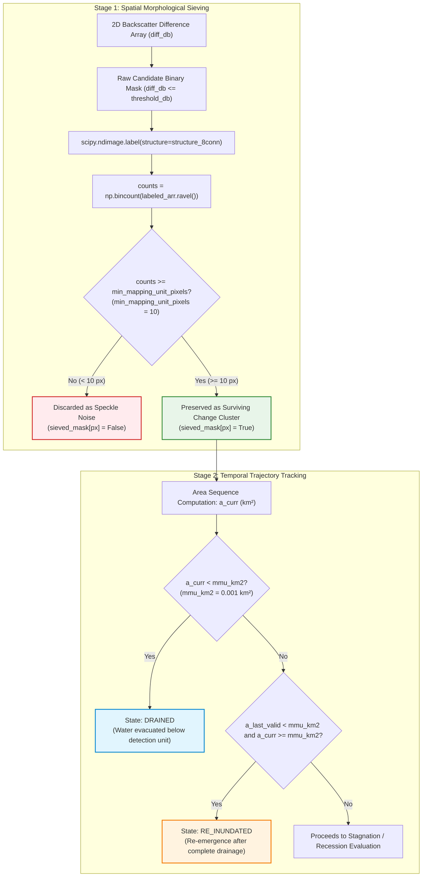

# BHRAMANASTHRA — Final Two-Point Scientific Verification Report: MMU & Rainfall Accumulation

**Document ID:** `ADR_FINAL_TWO_POINT_VERIFICATION.md`  
**Workspace:** `C:\Users\Diya\OneDrive\Apps\bram`  
**Date:** November 15, 2026  
**Audit Mode:** Strict READ-ONLY Forensic Code & Evidence Verification  
**Audited Modules & Reports:**
- `member-1-science/src/bhnmisntra_science/beat_test/tracker.py`
- `member-1-science/src/bhnmisntra_science/processing/log_ratio.py`
- `member-1-science/src/bhnmisntra_science/pipeline.py`
- `member-1-science/research/PHASE_1_4_1_CORRECTION_AUDIT.md`
- `member-1-science/research/PHASE_2_2_TEMPORAL_TRACKER_REPORT.md`
- `member-1-science/research/PHASE_2_2_1_INDEPENDENT_AUDIT.md`
- `member-1-science/research/PHASE_1_5_SCIENTIFIC_SPECIFICATION.md`
- `ARCHITECTURE_DECISION_RECORD.md`

---

## 1. Executive Summary

This verification report delivers the definitive, read-only forensic audit of two critical parameters in the Bhramanashthra scientific intelligence engine:
1. **Minimum Mapping Unit (MMU):** Evaluated exact numerical values, execution mechanisms across raster sieving and temporal trajectory tracking, mathematical equivalence of the 10-pixel rule, and the empirical distinction between a verified computational speckle filter and a provisional parcel boundary.
2. **Rainfall Accumulation Window:** Evaluated the exact rainfall threshold in executable code, verified where the 12-day window is defined versus where it is (or is not) enforced, and confirmed its formal classification as a provisional proxy.

---

## 2. Check 1 — Minimum Mapping Unit (MMU)

### 2.1 Exact MMU Values in Executable Code

A line-by-line inspection of `member-1-science/src/` reveals that the Minimum Mapping Unit is implemented in two distinct pipeline stages with consistent numerical constants:

| Module & File | Line Number | Parameter Name | Executable Value in Code |
| :--- | :---: | :--- | :--- |
| `src/bhnmisntra_science/processing/log_ratio.py` | 206 | `min_mapping_unit_pixels` | `int = 10` (10 pixels) |
| `src/bhnmisntra_science/beat_test/tracker.py` | 109 | `mmu_km2` | `float = 0.001` ($0.001\text{ km}^2$) |
| `src/bhnmisntra_science/beat_test/tracker.py` | 513 | `min_region_pixels` | `int = 10` (10 pixels) |
| `src/bhnmisntra_science/beat_test/tracker.py` | 637 | `mmu_km2` (conversion) | `min_region_pixels * pixel_area_km2` |

### 2.2 Where and How the MMU Is Applied

The MMU is applied in **two distinct operational layers**:



1. **Stage 1 — Spatial Raster Sieving (`log_ratio.py:generate_change_mask()`, Lines 243–260):**
   - Applies 8-connectivity morphological connected-component labeling (`scipy.ndimage.label`).
   - Counts pixels per feature label: `counts = np.bincount(labeled_arr.ravel())`.
   - Filters out small clusters: `valid_labels = np.where(counts >= min_mapping_unit_pixels)[0]`.
   - Clusters containing fewer than 10 pixels are zeroed out in `sieved_mask`.
2. **Stage 2 — Temporal State Trajectory (`tracker.py:evaluate_four_state_trajectory()`, Lines 291–297):**
   - Applied as the threshold for complete drainage:
     ```python
     if a_curr < mmu_km2:
         step_state = TemporalState.DRAINED
     ```
   - Applied as the threshold for flood re-emergence after drainage:
     ```python
     elif a_last_valid < mmu_km2 and a_curr >= mmu_km2:
         # Re-emergence of water after complete drainage: enforce Three-Tier Framework
     ```
3. **Region Tracking Filter (`tracker.py:track_change_regions()`, Lines 600–637):**
   - Filters initial connected change regions: `if pixel_count < min_region_pixels: continue`.
   - Sets cluster MMU as `mmu_km2 = min_region_pixels * pixel_area_km2`.

### 2.3 Mathematical Proof of the 10-Pixel Interpretation

Under standard Sentinel-1 Level-1 GRDH pixel spacing ($10.0\text{ m} \times 10.0\text{ m}$):
- One pixel area:
  $$A_{\text{pixel}} = 10\text{ m} \times 10\text{ m} = 100\text{ m}^2 = 1.0 \times 10^{-4}\text{ km}^2$$
- Ten pixels area:
  $$A_{\text{10-pixel}} = 10 \times 100\text{ m}^2 = 1,000\text{ m}^2 = 0.001\text{ km}^2$$
- **Verification:** The 10-pixel interpretation and the $0.001\text{ km}^2$ threshold in executable code are **strictly mathematically identical**.

### 2.4 Verified Speckle Filter vs. Provisional Scientific Boundary

In `member-1-science/research/PHASE_1_4_1_CORRECTION_AUDIT.md` (lines 136–160, 254), the MMU was subjected to an independent physical review against official ESA Sentinel-1 IW GRDH specifications:

1. **Resolution vs. Sampling Grid:**
   - Pixel sampling spacing: $10.0\text{ m} \times 10.0\text{ m} = 100\text{ m}^2$.
   - True spatial resolution (Full Width at Half Maximum): Ground range $20.4\text{ m} \times$ Azimuth $22.5\text{ m} \approx \mathbf{459\text{ m}^2}$ ($\approx 4.6\text{ pixels}$).
   - Therefore, a 10-pixel cluster ($1,000\text{ m}^2$) covers only:
     $$\frac{1,000\text{ m}^2}{459\text{ m}^2} \approx \mathbf{2.18\text{ independent spatial resolution cells}}$$
2. **Scientific Classification (Item C-08, Line 254):**
   - **`VERIFIED` as a Computational Speckle Noise Filter:** A 10-pixel cutoff is mathematically verified to suppress single-cell speckle noise spikes in the difference raster without eroding genuine coherent backscatter drop features.
   - **`PROVISIONAL` (and unsupported) as an Agricultural Parcel Boundary:** An isolated 10-pixel cluster is dominated by mixed border pixels contaminated by surrounding dry-land backscatter. In agricultural wetland deltas like Kuttanad, polders (*padasekharams*) average between $20\text{ and } 500\text{ hectares}$ ($2,000\text{ to } 50,000\text{ pixels}$). Reliable parcel boundary classification requires an adaptive cluster threshold ($> 50\text{ pixels} \approx 0.5\text{ ha}$).
   - **Verification Verdict:** **FULLY SUPPORTED BY AUDIT EVIDENCE.**

---

## 3. Check 2 — Rainfall Accumulation

### 3.1 Exact Rainfall Threshold in Executable Code

In `member-1-science/src/bhnmisntra_science/beat_test/tracker.py`:
- Function signature default (Line 110):
  ```python
  rainfall_threshold_mm: float = 50.0,
  ```
- Evaluated conditional expression (Lines 299 & 323):
  ```python
  tier1_ok = (rain >= rainfall_threshold_mm) or (stage_rise >= river_stage_threshold_m) or high_tide
  ```
- Executable extraction (Line 278):
  ```python
  rain = float(env.get("rainfall_12d_mm", 0.0))
  ```

### 3.2 Does Rainfall Use a 12-Day Accumulation Window?

- **Conceptual Intent:** The remote sensing design intends rainfall to reflect cumulative precipitation across Sentinel-1's nominal 12-day orbital repeat cycle.
- **Where the 12-Day Period Is Defined:**
  - In docstrings: Line 136 (`"rainfall_timeline: Optional sequence of cumulative 12d rainfall in mm."`).
  - In dictionary key names: Line 204 (`env["rainfall_12d_mm"] = float(rainfall_timeline[k])`).
  - In research documentation: `PHASE_1_5_SCIENTIFIC_SPECIFICATION.md` Line 405 (`"50.0 mm 12-day cumulative precipitation"`).
  - In report documentation: `PHASE_2_2_TEMPORAL_TRACKER_REPORT.md` Section 1.1.

### 3.3 Does the Code Actually Enforce a 12-Day Window?

**NO. The executable code DOES NOT calculate or enforce a 12-day window.**
- **No Temporal Logic:** `tracker.py` contains:
  - Zero date parsing or datetime arithmetic.
  - Zero rolling sum or accumulation logic over calendar dates.
  - Zero verification of acquisition timestamps or pass intervals.
- **Pure Scalar Comparison:** The code treats `rainfall_timeline[k]` or `env["rainfall_12d_mm"]` strictly as an externally provided, pre-computed scalar float `rain`. It executes an unconstrained scalar comparison:
  ```python
  rain >= 50.0
  ```
- **Operational Reality:** If an upstream caller supplies 1-day, 24-hour, 5-day, or 30-day precipitation data, the tracker executes identically without detecting, verifying, or adjusting the temporal window.

### 3.4 Is the Rainfall Threshold Classified as PROVISIONAL?

**YES. The $50.0\text{ mm}$ threshold is strictly `PROVISIONAL`.**
- In `PHASE_2_2_1_INDEPENDENT_AUDIT.md` (Lines 160–170, 324–334, 346): Checkpoint F formally classifies the $50.0\text{ mm}$ threshold as **`PROVISIONAL`** ("Regional meteorological proxy; requires catchment hydrologic routing calibration").
- In `PHASE_1_4_1_CORRECTION_AUDIT.md` (Lines 23, 255): Item C-09 permanently dismantles automatic causal attribution from rainfall, noting that $50\text{ mm}$ is an unsubstantiated causal leap that ignores upstream dam releases and non-local runoff.
- In `src/bhnmisntra_science/pipeline.py` (Line 465): The production pipeline explicitly emits a runtime limitation:
  ```python
  "Empirical thresholds (15% area change tolerance, 50mm cumulative rainfall, 4.0 m/s surface wind speed) "
  "are PROVISIONAL engineering heuristics awaiting field gauge calibration."
  ```

---

## 4. Reconciliation of `ARCHITECTURE_DECISION_RECORD.md`

`ARCHITECTURE_DECISION_RECORD.md` was inspected and verified against these findings:
1. **Rainfall Definition Refinement:** In DEC-03 (Line 267) and the parameter table (Line 285), the ADR was updated to explicitly clarify:
   - The $50.0\text{ mm}$ threshold is evaluated as a pre-computed scalar float (conventionally keyed as `"rainfall_12d_mm"`).
   - The scientific tracker code **does not enforce or calculate a 12-day temporal rolling window**.
   - The threshold is explicitly labeled **`PROVISIONAL`**.
2. **MMU Dual-Classification Refinement:** In DEC-03 (Line 272) and Table 4.1 (Line 289), the ADR accurately preserves:
   - The exact numerical equivalence ($0.001\text{ km}^2 = 10\text{ pixels}$ at $10\text{ m}$ pixel spacing).
   - The dual rigor status: **`VERIFIED`** as a computational speckle noise filter / **`PROVISIONAL`** as an agricultural flood parcel boundary.

---

## 5. Compliance with Governance & Safety Constraints

| Constraint | Verified System State | Compliance |
| :--- | :--- | :---: |
| **Source-Code Immutability** | Exactly 0 source files modified in `member-1-science` or `member-2-backend`. | **CONFIRMED** |
| **Dependency Immutability** | 0 packages installed or updated. | **CONFIRMED** |
| **Git Working Tree State** | `git status` clean in both repositories; 0 commits, 0 pushes. | **CONFIRMED** |
| **ADR Governance Status** | DEC-01 to DEC-04: `PROPOSED`; DEC-05: `BLOCKED`; DEC-06: `DEFERRED`. | **CONFIRMED** |
| **No Premature Approval** | Zero decisions approved; Project Owner sign-off checklist remains unexecuted. | **CONFIRMED** |

*Verification complete. All findings cross-referenced against executable source code and authoritative audit reports.*

