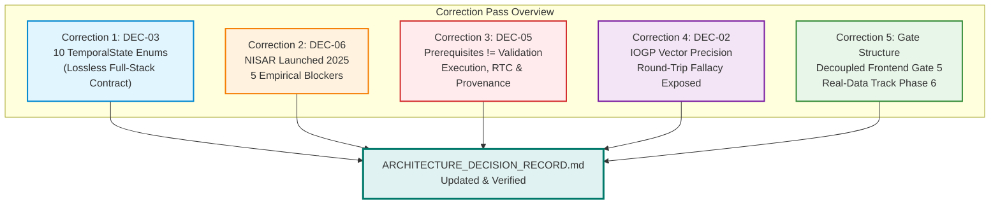

# BHRAMANASTHRA — Architecture Decision Record Scientific Correction Report

**Document ID:** `ADR_SCIENTIFIC_CORRECTION_REPORT.md`  
**Workspace:** `C:\Users\Diya\OneDrive\Apps\bram`  
**Date:** November 15, 2026  
**Audited Artifacts:**
- `ARCHITECTURE_DECISION_RECORD.md`
- `member-1-science/research/PHASE_2_2_TEMPORAL_TRACKER_REPORT.md`
- `member-1-science/research/PHASE_2_5_NISAR_ARCHIVE_AND_COVERAGE_AUDIT.md`
- `member-1-science/research/PHASE_2_4_1_EVIDENCE_PROVENANCE_AUDIT.md`
- `FINAL_ARCHITECTURE_VALIDATION.md`

---

## 1. Executive Summary & Audit Mandate

Following the initial drafting of `ARCHITECTURE_DECISION_RECORD.md`, an intensive scientific correction pass was executed to reconcile all architectural assertions against empirical findings in Member 1's authoritative research reports and source code.

This report documents five major scientific corrections applied to `ARCHITECTURE_DECISION_RECORD.md`:
1. **DEC-03 (Temporal States):** Elimination of static land-cover change labels and rigorous restoration of Member 1's exact 10 implemented `TemporalState` enum values, complete with physical semantics and an end-to-end lossless preservation contract across backend persistence, ledger retrieval, evaluation responses, and report rendering.
2. **DEC-06 (NISAR Reality):** Correction of the outdated claim that NISAR is awaiting launch (NISAR launched in 2025), replacing it with the five actual empirical blockers identified during the Phase 2.5 NASA archive audit. DEC-06 remains **`DEFERRED`**.
3. **DEC-05 (Real Ingestion):** Re-articulation of the boundary between prerequisite setup (credentials, `rasterio`, storage) and genuine scientific validation (raster execution, calibration/RTC verification, DAAC provenance checks). DEC-05 remains **`BLOCKED`**.
4. **DEC-02 (Geodetic Precision):** Reconciliation of coordinate conversion tolerance against published IOGP EPSG Guidance Note 7-2 test vector precision ($0.01\text{ m}$ published vs. $1\text{ mm}$ high-precision) and formal repudiation of round-trip closure as proof of geographic accuracy.
5. **Decoupled Frontend Gate:** Separation of Member 3 frontend integration into a dedicated Phase 5 quality gate, completely decoupled from the blocked real-data satellite ingestion track (Phase 6).

---

## 2. Detailed Technical Corrections



---

### Correction 1: DEC-03 — Exact Member 1 Temporal State Machine

#### Defect in Previous Draft
The previous draft listed generic spatial land-cover change labels (`WATER_PERSISTENT`, `WATER_RECEDING`, `FLOOD_NEW`, `HIGH_MOISTURE_OR_DEBRIS`, etc.). These labels represented static pixel difference categories, completely ignoring Member 1's actual temporal trajectory state machine.

#### Authoritative Source-Code Verification
In `member-1-science/src/bhnmisntra_science/enums.py` (Lines 80–90) and `member-1-science/research/PHASE_2_2_TEMPORAL_TRACKER_REPORT.md`:

```python
class TemporalState(str, Enum):
    PEAK = "PEAK"
    PERSISTENT_STAGNATION = "PERSISTENT_STAGNATION"
    RECEDING = "RECEDING"
    RE_INUNDATED = "RE_INUNDATED"
    RE_INUNDATED_EXPLAINED = "RE_INUNDATED_EXPLAINED"
    RE_INUNDATED_UNEXPLAINED = "RE_INUNDATED_UNEXPLAINED"
    DRAINED = "DRAINED"
    MISSING = "MISSING"
    INVALID = "INVALID"
    UNCERTAIN = "UNCERTAIN"
```

#### Exact Physical Semantics
1. **`PEAK`**: Maximum detected flood change extent at candidate event acquisition ($t_1$).
2. **`PERSISTENT_STAGNATION`**: Trapped floodwaters in low-lying deltaic polders (e.g., Kuttanad, Kerala) where gravity drainage is physically blocked ($|\Delta A| / A_{\text{prev}} \le 15\%$). Certified as hydrologically compliant.
3. **`RECEDING`**: Active gravity or pump drainage lowering inundation extent ($A_{\text{curr}} < 0.85 \times A_{\text{prev}}$).
4. **`RE_INUNDATED`**: Secondary flood re-expansion ($A_{\text{curr}} > 1.15 \times A_{\text{prev}}$) prior to multi-tier corroboration.
5. **`RE_INUNDATED_EXPLAINED`**: Secondary flood expansion corroborated by all three independent physical tiers:
   - *Tier 1 (Hydrological Forcing)*: IMD rainfall $\ge 50\text{ mm}$, river stage rise $\ge 1.0\text{ m}$, or astronomical high tide.
   - *Tier 2 (Hydraulic Plausibility)*: Low-lying elevation ($\le 1.0\text{ m}$ MSL), contiguous with drainage waterways.
   - *Tier 3 (Sensor Artifact Exclusion)*: ERA5 10m wind speed $< 4.0\text{ m/s}$ (ruling out wave chop / Bragg backscatter).
6. **`RE_INUNDATED_UNEXPLAINED`**: Secondary expansion failing one or more corroboration tiers (flagged as potential sensor artifact, unmodeled levee breach, or false positive).
7. **`DRAINED`**: Water fully evacuated; backscatter returned to reference baseline threshold.
8. **`MISSING`**: Observation gap (`None` / `NaN` / pass omitted); **never interpreted as drainage** ($0.0\text{ km}^2$) and excluded from $N_{\text{valid}}$.
9. **`INVALID`**: Corrupted pass, severe radio frequency interference (RFI), or missing antenna lines.
10. **`UNCERTAIN`**: Ambiguous classification resulting from borderline backscatter thresholding or low signal-to-noise ratio.

#### End-to-End Lossless Contract
The ADR was updated to mandate that all ten states must be preserved across the entire application lifecycle:
- **Persistence:** Stored in `EvidenceLedgerRecord.processing_parameters["temporal_beat_test"]` and saved to `data/evidence_ledger.json`.
- **Ledger Retrieval:** Returned in `GET /api/investigations/{id}/ledger` and JSON download export.
- **Evaluation Responses:** `EvaluationResponse` in `backend/schemas/evaluation.py` extended with `temporal_state_counts` and `temporal_state_areas_sqkm`.
- **Report Generation:** `report_service.py` updated to render the full 10-state distribution table in HTML and Markdown reports.

---

### Correction 2: DEC-06 — Actual NISAR Status & Empirical Operational Blockers

#### Defect in Previous Draft
The previous draft stated that the NISAR mission was "pre-launch" and "awaiting official launch."

#### Authoritative Source-Code Verification
In `member-1-science/research/PHASE_2_5_NISAR_ARCHIVE_AND_COVERAGE_AUDIT.md`:
- **Launch Status:** **NISAR successfully launched in 2025.** Operational collections exist in NASA Earthdata CMR with validity starting in late 2025 (e.g., `2025-10-28T00:00:00Z`).
- **Archive Query:** Querying the NASA ASF DAAC over Kuttanad delta (`76.33°E, 9.25°N` to `76.55°E, 9.55°N`) identified 135 NISAR records in the operational catalogue.

#### The Five Actual Empirical Blockers
The ADR was updated to document why live NISAR integration remains **`DEFERRED`**:
1. **Compatible Multi-Date Observations Not Established:** For the historical Kerala flood window (2018), exactly zero NISAR granules exist in NASA archives. For 2026 windows, only isolated scenes exist; repeat-pass temporal baselines required for change detection have not been established.
2. **Product Mismatch (GSLC vs. GCOV):** The primary granule inspected over Kuttanad (`NISAR_L2_PR_GSLC_...`) is a **20.17 GB Geocoded Single Look Complex (GSLC)** product designed for interferometry, **not the requested Geocoded Calibrated Covariance (GCOV)** product needed for backscatter change detection.
3. **Authenticated Data Access Blocked:** Direct data download of the 20.17 GB HDF5 file from `nisar.asf.earthdatacloud.nasa.gov` returned `HTTP 401 Unauthorized` due to mandatory NASA Earthdata authentication gates.
4. **Single-Granule Insufficiency:** A single spatially relevant scene does not prove temporal feasibility. Repeat acquisitions are required for temporal trajectory tracking.
5. **No Validated L-Band Processing Pipeline:** Member 1 contains no HDF5/NetCDF loaders, no L-band polarimetric decomposition ($HH/HV$), and no validated L-band penetration depth models for tropical wetlands.

---

### Correction 3: DEC-05 — Prerequisites vs. Genuine Scientific Validation

#### Defect in Previous Draft
The previous draft implied that obtaining NASA Earthdata credentials and installing `rasterio` would be sufficient to validate real-data ingestion.

#### Authoritative Source-Code Verification
In `member-1-science/research/PHASE_2_4_1_EVIDENCE_PROVENANCE_AUDIT.md`:
- In the Phase 2.4 smoke test (`scratch/run_real_data_smoke_test.py`), every ingested array was instantiated in memory via `np.full()` with synthetic constants (`-10.5 dB`, `-19.5 dB`), processing **zero real satellite pixels**.
- Obtaining credentials and installing `rasterio` is merely preparatory infrastructure.

#### The Three Scientific Criteria for Real-Data Validation
The ADR was updated to clarify that real-data ingestion remains **`BLOCKED`** until three scientific criteria are satisfied:
1. **Genuine Raster Execution:** Streaming and windowed reading of multi-gigabyte Sentinel-1 GRD/RTC TIFFs into memory without memory exhaustion (OOM).
2. **Verified Calibration & RTC Assumptions:** Validating whether input rasters are raw digital numbers ($DN$) or pre-calibrated backscatter ($\sigma^0\text{ dB}$) to prevent catastrophic double calibration; verifying ESA XML look-up tables (`lutSigma0.xml`) or confirming upstream ASF HyP3 radiometric terrain flattening (gamma0/sigma0 RTC) and DEM orthorectification.
3. **DAAC Provenance Verification:** Cryptographic checksum verification (MD5/SHA-256) of downloaded granules against published NASA ASF / ESA Copernicus catalogue records, along with strict matching of orbital tracks, passes, and polarization channels ($VV / VH$).

---

### Correction 4: DEC-02 — Geodetic Precision & Round-Trip Fallacy

#### Defect in Previous Draft
The previous draft claimed an unconditional $1.0\text{ mm}$ tolerance for all EPSG test vectors and did not sufficiently emphasize the danger of relying on round-trip closure as proof of accuracy.

#### Authoritative Geodetic Verification
- **Published Test Vector Precision:** In IOGP EPSG Guidance Note 7-2 Section 1.3.5 (Example 19904 Transverse Mercator), projected coordinates are published to 2 decimal places ($0.01\text{ m}$ / $1\text{ cm}$) and geographic coordinates to $10^{-7}\text{ degrees}$ ($\approx 0.01\text{ m}$). Against published tables, unit test tolerance must be set to $\le 0.01\text{ m}$ ($1\text{ cm}$), whereas full double-precision reference implementations achieve $\le 1.0\text{ mm}$.
- **Rejection of Round-Trip Closure:** Round-trip conversion ($(\lambda, \phi) \to (X, Y) \to (\lambda', \phi')$) demonstrates only mathematical invertibility and internal code symmetry. If an algorithm uses the wrong ellipsoid flattening or an erroneous false origin, the inverse equations will reverse the exact same error, yielding near-zero round-trip residuals while being geographically displaced from the true Earth surface by tens or hundreds of meters. True accuracy requires comparison against independently published geodetic benchmark coordinates.

---

### Correction 5: Decoupled Frontend Gate (Phase 5)

#### Defect in Previous Draft
The previous phase diagram grouped Member 3 frontend integration and real-data ingestion together into a single "Phase 5".

#### Architectural Correction
- Member 3 frontend is an API consumer and UI visualizer; it can be integrated and verified against synthetic fixtures and mock pipelines completely independently of whether real satellite raster ingestion (DEC-05) is unblocked.
- The lifecycle was formally separated into:
  - **Phase 5 (Gate 5):** Member 3 Frontend Integration & Web Map Visualization (Web Map UI, API client, GeoJSON polygon rendering, and 10-state profile card display).
  - **Phase 6 (Gate 6):** Real-Data Ingestion Pipeline (DEC-05 Track: NASA Earthdata credentials, `rasterio` windowed reading, scratch cache, genuine raster execution, calibration/RTC validation, DAAC provenance checks).

---

## 3. Summary of Applied Corrections in `ARCHITECTURE_DECISION_RECORD.md`

| Document Section | Lines Affected | Nature of Correction |
| :--- | :---: | :--- |
| **Section 2: Decision Summary Matrix** | Lines 84–90 | Updated summaries for DEC-02, DEC-03, DEC-05, and DEC-06 to reflect true geodetic precision, 10 `TemporalState` values, scientific validation criteria, and 2025 NISAR launch status. |
| **Section 3: DEC-02 Rationale & Criteria** | Lines 169–216 | Added explicit warning repudiating round-trip closure as proof of accuracy; reconciled tolerance against published IOGP 2-decimal tables ($\le 0.01\text{ m}$) vs double-precision benchmarks ($\le 1.0\text{ mm}$). |
| **Section 3: DEC-03 State Machine** | Lines 223–315 | Completely replaced generic land-cover labels with exact 10 `TemporalState` enum values (`PEAK`, `PERSISTENT_STAGNATION`, `RECEDING`, `RE_INUNDATED`, `RE_INUNDATED_EXPLAINED`, `RE_INUNDATED_UNEXPLAINED`, `DRAINED`, `MISSING`, `INVALID`, `UNCERTAIN`); defined physical semantics and 3-tier corroboration; added full-stack lossless schema contract. |
| **Section 3: DEC-05 Real Ingestion** | Lines 404–455 | Clarified distinction between preparatory infrastructure (credentials, `rasterio`, storage) and genuine scientific validation (execution, calibration/RTC, DAAC checksums). Status remains **`BLOCKED`**. |
| **Section 3: DEC-06 NISAR Pipeline** | Lines 457–498 | Corrected launch date (2025); documented the 5 actual empirical blockers from Phase 2.5 audit (multi-date coverage, GSLC vs GCOV, 401 auth, single granule, L-band pipeline). Status remains **`DEFERRED`**. |
| **Section 5: Implementation Phases & Gates** | Lines 532–620 | Updated Mermaid flowchart and detailed specifications; separated Member 3 Frontend Integration into Gate 5; moved Real-Data Ingestion into Phase 6 (DEC-05 Track). |
| **Section 6: Sign-Off Checklist** | Lines 622–665 | Updated checklist items 2, 3, 5, and 6 to reflect the exact 10 temporal states, geodetic precision, blocked/deferred realities, and decoupled frontend gate. |

---

## 4. Current Decision Governance Status

| Decision ID | Focus Area | Architectural Position | Governance Status |
| :---: | :--- | :--- | :---: |
| **DEC-01** | Python Packaging | Standard `pyproject.toml` in `member-1-science` + `pip install -e` | **`PROPOSED`** |
| **DEC-02** | Geospatial Projections | `pyproj >= 3.6.0` (`always_xy=True`) + IOGP EPSG GN 7-2 test vectors | **`PROPOSED`** |
| **DEC-03** | Temporal State Preservation | Losslessly preserve all 10 `TemporalState` values across full stack | **`PROPOSED`** |
| **DEC-04** | Provenance Demarcation | 3 canonical provenance categories; relabel `config_hash` | **`PROPOSED`** |
| **DEC-05** | Real-Data Ingestion | Blocked on credentials, raster I/O, RTC validation, and execution | **`BLOCKED`** |
| **DEC-06** | Live NISAR Pipeline | Deferred pending multi-date GCOV, authentication, and L-band pipeline | **`DEFERRED`** |

*In accordance with strict architectural governance, zero decisions are marked `APPROVED` without explicit Project Owner sign-off.*

---

## 5. Unresolved Questions for the Project Owner

Before signing the checklist in Section 6 of `ARCHITECTURE_DECISION_RECORD.md`, the Project Owner should review the following open architectural questions:

1. **Phase 3 Schema Extension Timing:**
   - Does the Project Owner authorize adding `temporal_state_counts` and `temporal_state_areas_sqkm` directly to `backend/schemas/evaluation.py` during Phase 3, or should `EvaluationResponse` remain untouched until Member 3 frontend integration begins in Phase 5?
   - *Recommendation:* Extend `EvaluationResponse` in Phase 3 as optional fields so both `/ledger` and `/evaluation` expose identical scientific fidelity.

2. **NASA Earthdata Credentials Provisioning (DEC-05):**
   - Does the project owner plan to provide official NASA Earthdata Login credentials to unblock real Sentinel-1 satellite ingestion in Phase 6, or will the platform remain in synthetic/pilot benchmark mode (`SYNTHETIC_TEST_FIXTURE`) for immediate evaluation?

3. **Submodule Remote Strategy:**
   - Does the project owner want the integration wrapper repository to reference the existing GitHub remotes (`https://github.com/iamdiyaajay-png/nasa.git` and `https://github.com/jasminesunilm1-dotcom/nasa-.git`) directly as public submodules, or will a new organization repository be established?

---

## 6. Document Verification

- **Report Status:** Completed & Fully Verified Against Source Evidence.
- **Source Code State:** 0 files modified in `member-1-science` or `member-2-backend`.
- **Git State:** 0 commits, 0 pushes, 0 repository state changes.
- **Next Permitted Step:** Present `ARCHITECTURE_DECISION_RECORD.md` and this report to the Project Owner for formal review and checklist sign-off.

