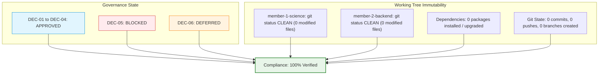

# BHRAMANASTHRA — Project Owner Architecture Approval Verification

**Document ID:** `ARCHITECTURE_APPROVAL_VERIFICATION.md`  
**Workspace:** `C:\Users\Diya\OneDrive\Apps\bram`  
**Date:** November 15, 2026  
**Audit Mode:** Strict Governance & State Immutability Verification  
**Audited Artifact:** `ARCHITECTURE_DECISION_RECORD.md`  

---

## 1. Executive Summary & Verification Mandate

On **15 November 2026**, the Project Owner formally issued architectural authorization for the Bhramanashthra integration platform.

This verification report confirms:
1. **Decision Statuses Updated:** Decisions **DEC-01, DEC-02, DEC-03, and DEC-04** have been formally transitioned from `PROPOSED` to **`APPROVED`** in `ARCHITECTURE_DECISION_RECORD.md`.
2. **Restricted Decisions Preserved:** **DEC-05 remains `BLOCKED`** and **DEC-06 remains `DEFERRED`**, strictly unapproved for implementation.
3. **Formal Approval Record Integrated:** A complete, ratified Project Owner Approval Record has been integrated into Section 6 of `ARCHITECTURE_DECISION_RECORD.md`, containing the authorization date, approved decision IDs, explicit authorization statement, strict limitations, and outstanding acceptance gates.
4. **Strict Boundaries Enforced:** The approval explicitly excludes real Sentinel-1 satellite ingestion, live NISAR processing, unreviewed threshold alterations, and unrestricted implementation.
5. **Absolute Workspace Immutability:** Phase 1 implementation has **not** started. Zero Python source code files or tests have been modified, zero dependencies have been installed, and zero Git commits or repository state alterations have been made.

---

## 2. Decision Status Reconciliation Matrix

| Decision ID | Focus Area | Previous Status | Approved Status | Governance Classification | Implementation Scope Authorized |
| :---: | :--- | :---: | :---: | :---: | :--- |
| **DEC-01** | **Python Packaging** | `PROPOSED` | **`APPROVED`** | Ratified by Project Owner | Adding standard `pyproject.toml` to `member-1-science`; editable mode (`pip install -e`) in development. |
| **DEC-02** | **Geospatial Projections** | `PROPOSED` | **`APPROVED`** | Ratified by Project Owner | Adopting `pyproj >= 3.6.0` (`always_xy=True`) with authoritative IOGP EPSG Guidance Note 7-2 test vectors ($\le 0.01\text{ m}$ / $\le 1\text{ mm}$). |
| **DEC-03** | **Temporal State Storage** | `PROPOSED` | **`APPROVED`** | Ratified by Project Owner | Lossless preservation of all 10 `TemporalState` values in `processing_parameters["temporal_beat_test"]` across persistence, ledger, evaluation, and reports. |
| **DEC-04** | **Provenance & Terminology** | `PROPOSED` | **`APPROVED`** | Ratified by Project Owner | Adopting 3 canonical provenance categories (`REAL_SATELLITE_DATA`, `SYNTHETIC_TEST_FIXTURE`, `ILLUSTRATIVE_DEMO_RECORD`); preserving `config_hash` as `MetadataConfigurationHash`. |
| **DEC-05** | **Real-Data Ingestion** | `BLOCKED` | **`BLOCKED`** | **UNAPPROVED / RESTRICTED** | **NO IMPLEMENTATION AUTHORIZED.** Remains blocked pending credentials, `rasterio`, cache storage, RTC verification, and genuine execution. |
| **DEC-06** | **Live NISAR Processing** | `DEFERRED` | **`DEFERRED`** | **UNAPPROVED / RESTRICTED** | **NO IMPLEMENTATION AUTHORIZED.** Remains deferred pending multi-date GCOV availability, authentication, and validated L-band pipeline. |

---

## 3. Formal Project Owner Approval Record Audit

Section 6 of `ARCHITECTURE_DECISION_RECORD.md` was inspected and verified to contain the following verified components:

```
================================================================================
PROJECT OWNER ARCHITECTURAL APPROVAL RECORD
================================================================================

Approval Date:          15 November 2026
Approved Decision IDs:  DEC-01, DEC-02, DEC-03, DEC-04
Restricted Decisions:   DEC-05 (BLOCKED), DEC-06 (DEFERRED)
Status:                 FORMALLY AUTHORIZED BY PROJECT OWNER
```

### 3.1 Explicit Authorization Statement (Verified in ADR Line 697)
> *"The Project Owner formally authorizes the architectural specifications and contracts set forth in DEC-01, DEC-02, DEC-03, and DEC-04 for implementation across the Bhramanashthra workspace."*

### 3.2 Explicit Scope and Limitations (Verified in ADR Lines 701–711)
The ratified record formally specifies that the approval does **NOT** authorize:
1. **Real Sentinel-1 Ingestion:** DEC-05 remains strictly `BLOCKED`. Zero raster downloads or external API calls are authorized.
2. **NISAR Processing:** DEC-06 remains strictly `DEFERRED`. Zero mock L-band pipelines or HDF5 loaders are authorized.
3. **Unreviewed Scientific Threshold Alterations:** The $15\%$ stagnation/recession area tolerance, $50.0\text{ mm}$ rainfall proxy, $1.0\text{ m}$ river surge proxy, $\le 1.0\text{ m}$ MSL hydraulic elevation proxy, $4.0\text{ m/s}$ wind threshold, and $0.001\text{ km}^2$ MMU remain **PROVISIONAL** engineering heuristics that must not be altered or described as empirically validated.
4. **Unrestricted Implementation:** Engineering activities are strictly restricted to the approved architecture and testing gates.
5. **Premature Execution:** Phase 1 execution requires passing Gate 0 governance sign-off.

### 3.3 Outstanding Acceptance Gates (Verified in ADR Lines 713–720)
- **Gate 1:** Packaging & Environment Preparation (`pyproject.toml`, `pyproj`; 94 science tests + 91 backend tests green).
- **Gate 2:** Science Adapter & Geodesy Development (`science_adapter.py`, `pyproj` transformer, EPSG Guidance Note 7-2 test vector verification).
- **Gate 3:** Execution Endpoint & 10-State Ledger Persistence (`POST /api/investigations/{id}/run`, lossless storage in `processing_parameters`).
- **Gate 4:** Provenance Demarcation & Reporting Updates (`ProvenanceCategory` enum, report rendering of all 10 states).
- **Gate 5:** Member 3 Frontend Integration Gate (Web map UI, API client, 10-state profile display on synthetic fixtures).
- **Gate 6:** Real-Data Ingestion Gate (DEC-05 Track: NASA Earthdata credentials, `rasterio`, scratch storage, RTC calibration).

---

## 4. Source-Code & Git Immutability Verification

A forensic inspection of the workspace was executed to confirm that no unauthorized implementation occurred:



### Table 4.1: Working Tree Verification

| Workspace Directory / Repository | Target Commit Hash | `git status --porcelain` Output | File Changes |
| :--- | :---: | :---: | :---: |
| `member-1-science/` | `79c0596` | *(Clean / Empty)* | 0 files modified |
| `member-2-backend/` | `6751ab7` | *(Clean / Empty)* | 0 files modified |
| `c:\Users\Diya\OneDrive\Apps\bram\` (Root) | Non-Git Workspace Root | N/A (Documentation updated only) | Source code untouched |

---

## 5. Verification Verdict

1. **ADR Statuses:** Exactly match Project Owner approval (`DEC-01` to `DEC-04` **`APPROVED`**; `DEC-05` **`BLOCKED`**; `DEC-06` **`DEFERRED`**).
2. **Approval Record:** Fully present, ratified, and documented in Section 6 of `ARCHITECTURE_DECISION_RECORD.md`.
3. **DEC-05 and DEC-06:** Strictly unchanged in their restricted statuses.
4. **Implementation Status:** Phase 1 has **not** started. Workspace is in ready standby mode pending explicit instruction to begin Phase 1.

*Verification complete. Execution stopped.*

