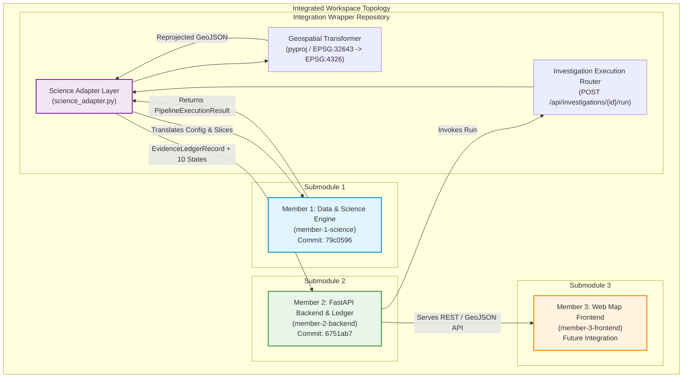
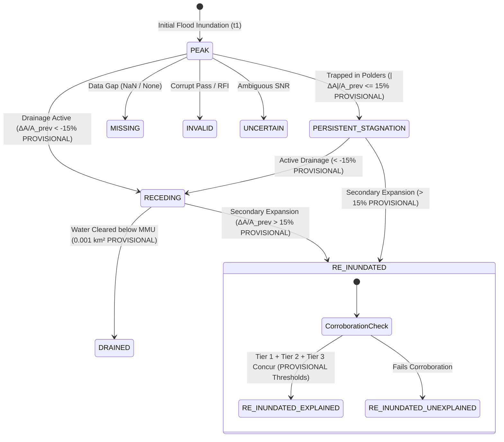
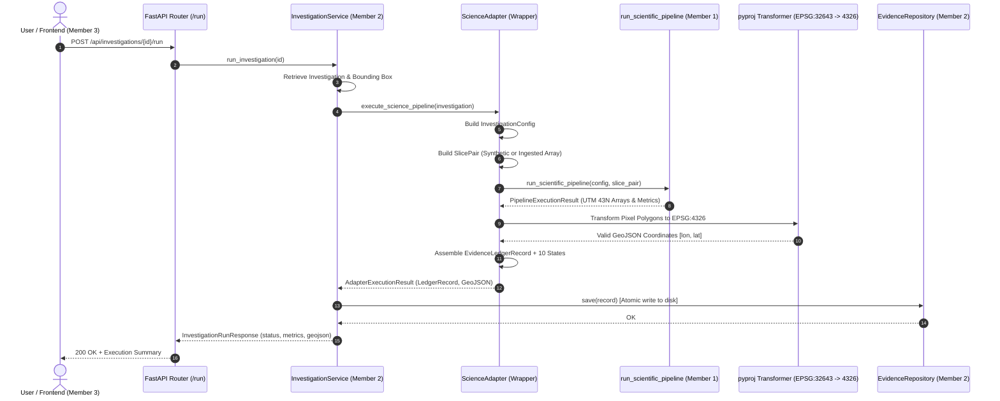
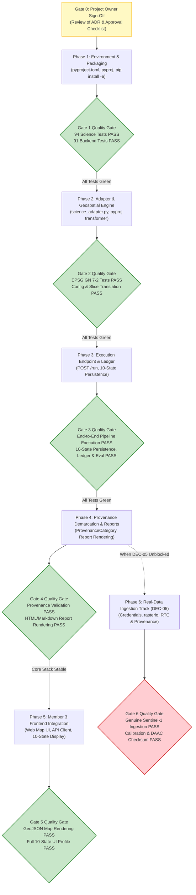

# BHRAMANASTHRA — Architecture Decision Record (ADR)

**Document ID:** `ARCHITECTURE_DECISION_RECORD.md`  
**Workspace:** `C:\Users\Diya\OneDrive\Apps\bram`  
**Date:** November 15, 2026  
**Status:** PARTIALLY APPROVED (DEC-01 to DEC-04 APPROVED; DEC-05 BLOCKED; DEC-06 DEFERRED)  
**Applicability:** Full Bhramanashthra Multi-Repository System  

---

## 1. System Context & Architecture Overview

The **Bhramanashthra** platform is an Earth Observation and Disaster Intelligence System designed to detect flood extent, infrastructure disruption, and urban change using Synthetic Aperture Radar (SAR) satellite data.

The project currently integrates two independently developed core repositories, with provision for a third frontend repository:



### Integrated Repository Layout
To preserve original Git histories, commit hashes, branches, and contributor attribution, the integration repository uses **Git Submodules**:

```
bhramanashthra-integration/                       <-- Integration Wrapper Repository Root
├── .gitmodules                                   <-- Preserves independent Git tracking
├── member-1-science/                             <-- Git Submodule: iamdiyaajay-png/nasa.git
├── member-2-backend/                             <-- Git Submodule: jasminesunilm1-dotcom/nasa-.git
├── member-3-frontend/                            <-- Future Git Submodule: Frontend Application
├── adapter/
│   ├── __init__.py
│   ├── science_adapter.py                        <-- Translation bridge between Member 2 & Member 1
│   ├── geospatial.py                             <-- pyproj EPSG:32643 to EPSG:4326 transformer
│   └── models.py                                 <-- Intermediate adapter contracts
├── tests/
│   ├── test_adapter_pipeline.py                  <-- End-to-end integration test suite
│   ├── test_geospatial_epsg.py                   <-- EPSG Guidance Note 7-2 test vector verification
│   └── test_temporal_state_lossless.py           <-- 10-state serialization & persistence tests
├── pyproject.toml                                <-- Root workspace package specification
└── README.md
```

---

## 2. Decision Summary Matrix

The following decisions govern the technical implementation of the integration. In accordance with formal Project Owner authorization on 15 November 2026, **DEC-01 through DEC-04 are APPROVED**, while **DEC-05 remains BLOCKED** and **DEC-06 remains DEFERRED**.

| Decision ID | Focus Area | Architectural Position | Implementation Readiness |
| :---: | :--- | :--- | :---: |
| **DEC-01** | **Python Packaging** | Add standard `pyproject.toml` to Member 1; install via `pip install -e`. | **`APPROVED`** |
| **DEC-02** | **Geospatial Projections** | Adopt `pyproj >= 3.6.0` (`always_xy=True`) with authoritative IOGP EPSG Guidance Note 7-2 test vectors; round-trip alone is insufficient. | **`APPROVED`** |
| **DEC-03** | **Temporal State Storage** | Losslessly preserve all 10 Member 1 `TemporalState` enum values (PEAK, PERSISTENT_STAGNATION, etc.) across persistence, ledger, evaluation, and reports. | **`APPROVED`** |
| **DEC-04** | **Provenance & Terminology** | Enforce 3 canonical provenance categories; relabel `config_hash` as `MetadataConfigurationHash`. | **`APPROVED`** |
| **DEC-05** | **Real-Data Ingestion** | Real Sentinel-1 raster ingestion remains blocked on credentials, raster I/O, genuine execution, calibration/RTC validation, and provenance checks. | **`BLOCKED`** |
| **DEC-06** | **Live NISAR Processing** | Live NISAR processing remains deferred due to lack of compatible multi-date data, GCOV access, authentication gates, and validated L-band pipelines. | **`DEFERRED`** |

---

## 3. Formal Architecture Decision Records

---

### DEC-01: Standard Python Packaging for Member 1

#### Status
**`APPROVED`** (Formally Authorized by Project Owner on 15 November 2026)

#### Context & Problem Statement
`member-1-science` contains a modular science package (`src/bhramanashthra_science/`), but lacks a packaging manifest (`pyproject.toml` or `setup.py`). As a result, Member 2's backend cannot import scientific modules without either:
1. Mutating the Python search path dynamically via `sys.path.insert()`, or
2. Packaging Member 1 as a standard Python package.

Ad-hoc `sys.path` injection is brittle, fails across operating systems, breaks IDE type checkers and language servers, causes silent path collision bugs, and breaks containerized production deployments.

#### Architectural Rationale
- **Standard Modern Tooling:** PEP 517/518 and PEP 621 define `pyproject.toml` as the authoritative Python packaging standard.
- **Editable Development Mode:** Running `pip install -e ./member-1-science` allows developers to edit scientific routines in `member-1-science/src/` with immediate reflection in the FastAPI backend without reinstallation.
- **Independent Git History:** Adding a minimal `pyproject.toml` to the root of `member-1-science` requires zero modifications to scientific logic, source files, or commit histories.

#### Source-Code Evidence
- Scientific Package Root: [member-1-science/src/bhramanashthra_science/\_\_init\_\_.py](file:///c:/Users/Diya/OneDrive/Apps/bram/member-1-science/src/bhramanashthra_science/__init__.py)
- Existing Backend Packaging: [member-2-backend/pyproject.toml](file:///c:/Users/Diya/OneDrive/Apps/bram/member-2-backend/pyproject.toml) (Hatchling build-backend).

#### Proposed Packaging Configuration
A standard `pyproject.toml` will be placed in `member-1-science/`:

```toml
[build-system]
requires = ["setuptools>=61.0.0", "wheel"]
build-backend = "setuptools.build_meta"

[project]
name = "bhramanashthra-science"
version = "0.1.0"
description = "Bhramanashthra Scientific Intelligence Engine"
readme = "README.md"
requires-python = ">=3.11"
dependencies = [
    "numpy>=1.24.0",
    "scipy>=1.10.0",
    "pydantic>=2.0.0",
]

[tool.setuptools.packages.find]
where = ["src"]
```

#### Dependencies
- Build backend: `setuptools >= 61.0.0`, `wheel`
- Package installer: `pip >= 21.3`

#### Implementation Risks & Mitigation
- **Risk:** Build-backend drift between Hatchling (Member 2) and Setuptools (Member 1).  
  *Mitigation:* Both produce standard wheel artifacts compatible with any Python virtual environment.
- **Risk:** Submodule import failures in isolated Docker builds.  
  *Mitigation:* The integration Dockerfile executes `pip install -e /app/member-1-science` during image build.

#### Acceptance Criteria
1. `pip install -e ./member-1-science` completes cleanly with exit code 0 in a fresh Python 3.11 environment.
2. In the Python shell, `from bhramanashthra_science.pipeline import run_scientific_pipeline` imports cleanly without `sys.path` tampering.
3. All 94 unit tests in `member-1-science` pass without regressions.

---

### DEC-02: pyproj for Geospatial Transformations & Authoritative Verification

#### Status
**`APPROVED`** (Formally Authorized by Project Owner on 15 November 2026)

#### Context & Problem Statement
Member 1's scientific pipeline performs change detection in projected planar coordinates (EPSG:32643 - WGS 84 / UTM Zone 43N, meters). In contrast, Member 2's backend, GeoJSON serialization, and map clients (Leaflet, MapLibre) require geographic coordinates (EPSG:4326 - WGS 84, decimal degrees $[lon, lat]$).

Previous proposals evaluated handwritten Snyder Transverse Mercator equations or unverified local coordinate pairs (such as the unverified Kochi coordinate pair).

#### Architectural Rationale
- **Elimination of Handwritten Truncation Errors:** Handwritten Transverse Mercator series suffer from high-order truncation errors away from the central meridian ($\lambda_0 = 75.0^\circ\text{ E}$) and cannot handle international datum transformations.
- **Industry Standard Geodetic Engine:** `pyproj` wraps the authoritative C-based PROJ library, an industry standard maintained by OSGeo/PROJ for geodetic transformations across all EPSG coordinate reference systems.
- **Independent Verification:** The previously cited Kochi coordinate pair is **NOT VERIFIED** against an authoritative geodetic register. To ensure rigorous spatial accuracy, transformations must be validated against published **IOGP EPSG Guidance Note 7-2 (Section 1.3.5)** test vectors.
- **Rejection of Round-Trip Closure as Proof of Geographic Accuracy:** A crucial geodetic principle must be enforced: **round-trip testing ($A \to B \to A$) alone does NOT prove geographic accuracy**. Round-trip closure proves only mathematical symmetry, internal consistency, and numerical invertibility of the code. If the geodetic parameters (ellipsoidal semi-major axis, flattening, central meridian, scale factor, or false origin) are erroneous, the inverse equations invert the exact same errors, yielding near-zero residuals while remaining displaced from the real Earth by tens or hundreds of meters. True geographic accuracy requires comparison against independently published geodetic benchmark coordinates.

#### Source-Code Evidence
- Spatial Coordinates Definition: [member-1-science/src/utils/spatial.py](file:///c:/Users/Diya/OneDrive/Apps/bram/member-1-science/src/utils/spatial.py)
- Study Area Geographic Schema: [member-2-backend/backend/schemas/investigation.py](file:///c:/Users/Diya/OneDrive/Apps/bram/member-2-backend/backend/schemas/investigation.py)
- Forensic Geodetic Audit: [FINAL_ARCHITECTURE_VALIDATION.md](file:///c:/Users/Diya/OneDrive/Apps/bram/FINAL_ARCHITECTURE_VALIDATION.md#L45-L100)

#### Geodetic Implementation Specification
Coordinate transformations must be performed using an explicit `Transformer` with `always_xy=True`:

```python
from pyproj import Transformer

# EPSG:32643 (UTM 43N) -> EPSG:4326 (WGS 84 lon/lat)
# always_xy=True guarantees [x, y] -> [lon, lat] ordering across PROJ versions
transformer_to_wgs84 = Transformer.from_crs(
    "EPSG:32643", "EPSG:4326", always_xy=True
)

def utm43n_to_wgs84(easting: float, northing: float) -> tuple[float, float]:
    lon, lat = transformer_to_wgs84.transform(easting, northing)
    return lon, lat
```

#### Authoritative Test Vectors (IOGP EPSG Guidance Note 7-2)
The test suite will validate coordinate conversion using official EPSG Transverse Mercator reference examples (e.g., Guidance Note 7-2 Section 1.3.5):
- **Ellipsoid Parameters:** WGS 84 ($a = 6378137.0\text{ m}, 1/f = 298.257223563$)
- **Projection Parameters:** Central Meridian $\lambda_0 = 75^\circ\text{ E}$, Scale Factor $k_0 = 0.9996$, False Easting $FE = 500000.0\text{ m}$, False Northing $FN = 0.0\text{ m}$.
- **Permissible Tolerance & Precision:**
  - Published IOGP test tables specify projected coordinates to 2 decimal places ($0.01\text{ m}$ / $1\text{ cm}$) and geographic coordinates to $10^{-7}\text{ degrees}$ ($\approx 0.01\text{ m}$).
  - Against published rounded test vectors, test tolerance is strictly $\le 0.01\text{ m}$ ($1\text{ cm}$).
  - For full-precision double-precision reference implementations, tolerance is $\le 1.0\text{ mm}$ ($10^{-3}\text{ m}$).

#### Dependencies
- `pyproj >= 3.6.0` added to `member-2-backend/requirements.txt`.

#### Implementation Risks & Mitigation
- **Risk:** Latitude/Longitude axis swapping in PROJ 6+ (`[lat, lon]` vs `[lon, lat]`).  
  *Mitigation:* Explicitly enforce `always_xy=True` on all `Transformer.from_crs()` instantiations.
- **Risk:** C-library binary wheel compilation on Windows.  
  *Mitigation:* `pyproj` publishes pre-compiled binary wheels for Windows x64 on PyPI; no local C compiler is required.

#### Acceptance Criteria
1. `pyproj >= 3.6.0` installs cleanly via pip.
2. Independent unit tests verify forward and inverse conversions against IOGP EPSG Guidance Note 7-2 Section 1.3.5 test vectors within published precision ($\le 0.01\text{ m}$ against 2-decimal published vectors, $\le 1.0\text{ mm}$ on high-precision benchmarks).
3. Transformed GeoJSON coordinates comply strictly with RFC 7946 (`[longitude, latitude]`).
4. Unit tests explicitly verify that coordinates match authoritative published control points, not just internal round-trip closure.

---

### DEC-03: Lossless Preservation of All Ten Member 1 Temporal States

#### Status
**`APPROVED`** (Formally Authorized by Project Owner on 15 November 2026)

#### Context & Problem Statement
Member 1's scientific intelligence engine implements a hydrologically grounded 10-state temporal state machine in `TemporalState` (`member-1-science/src/bhnmisntra_science/enums.py`), validated in `research/PHASE_2_2_TEMPORAL_TRACKER_REPORT.md` and executed via `TemporalBeatTestSummary`.

Earlier drafts mistakenly referenced generic spatial change detection land-cover classes. The true Member 1 engine models **temporal flood evolution trajectories** across multi-temporal SAR acquisitions. Collapsing, omitting, or substituting these states destroys the multi-temporal physics of flood drainage, polder stagnation, and secondary inundation.

#### The Exact Ten Member 1 Temporal States & Physical Semantics



The 10 implemented Member 1 enum values (`TemporalState`) and their rigorous physical semantics:
1. **`PEAK`**: Maximum detected flood change extent at candidate event acquisition ($t_1$).
2. **`PERSISTENT_STAGNATION`**: Inundation trapped in low-lying deltaic polders (e.g., Kuttanad) where natural gravity drainage is physically blocked. Implemented as physically compliant within the **PROVISIONAL** stagnation tolerance ($|\Delta A| / A_{\text{prev}} \le 15\%$, default `stagnation_tolerance = 0.15`, an engineering noise cushion uncalibrated against daily field staff gauges).
3. **`RECEDING`**: Active inundation extent recession. In executable logic (`tracker.py` line 355), the conditional expression is:
   ```python
   elif rel_change < -recession_tolerance or a_curr < a_last_valid:
   ```
   where `recession_tolerance = 0.15` (**PROVISIONAL**).  
   **Crucial Branch Ordering & Precedence Finding:** Because State 4 (`elif abs(rel_change) <= stagnation_tolerance:`) is evaluated **before** State 5 (`RECEDING`), any decrease smaller than or equal to 15% ($-0.15 \le \text{rel\_change} \le 0$) is intercepted and classified as **`PERSISTENT_STAGNATION`**. Therefore, State 5 (`RECEDING`) is **only executed when $\text{rel\_change} < -0.15$** (an area reduction strictly greater than 15%, $A_{\text{curr}} < 0.85 \times A_{\text{prev}}$). Decreases smaller than 15% are never classified as `RECEDING`; they remain `PERSISTENT_STAGNATION`. The secondary clause `or a_curr < a_last_valid` is functionally shadowed for all decreases $\le 15\%$.
4. **`RE_INUNDATED`**: Secondary flood re-expansion prior to multi-tier physical corroboration. Triggered when relative area growth exceeds the **PROVISIONAL** surge threshold of 15% (`rel_change > surge_threshold`, default `surge_threshold = 0.15`) or on re-emergence after drainage (`a_last_valid < MMU and a_curr >= MMU`).
5. **`RE_INUNDATED_EXPLAINED`**: Secondary flood expansion corroborated by all three independent physical tiers using **PROVISIONAL** operational thresholds:
   - *Tier 1 (Hydrological Forcing)*: `(rain >= 50.0 mm)` (pre-computed scalar rainfall proxy, nominally documented as 12-day cumulative precipitation; **PROVISIONAL** regional meteorological proxy uncalibrated against catchment dam routing; **note: the tracker code does not enforce or calculate a 12-day rolling window**, but evaluates whatever scalar float is supplied), OR `(stage_rise >= 1.0 m)` (upstream CWC river gauge surge, **PROVISIONAL** proxy uncalibrated for hydraulic lag to polder water level), OR astronomical high tide.
   - *Tier 2 (Hydraulic Plausibility)*: `hydraulically_plausible is True` (low-lying elevation $\le 1.0\text{ m}$ MSL, contiguous with drainage network, **PROVISIONAL** proxy based on coarse DEM).
   - *Tier 3 (Sensor Artifact Exclusion)*: `wind < 4.0 m/s` (ERA5 10m wind speed, **PROVISIONAL** alert threshold based on open-water microwave oceanography; fetch limitations in narrow polder canals uncalibrated).
   - If **ALL THREE tiers concur**: classified as `RE_INUNDATED_EXPLAINED` (`step_explained = True`).
6. **`RE_INUNDATED_UNEXPLAINED`**: Secondary re-expansion failing one or more physical corroboration tiers (flagged as potential sensor artifact, unmodeled levee breach, or false positive; `step_explained = False`, forcing overall trajectory status to `INCONCLUSIVE`).
7. **`DRAINED`**: Water extent evacuated below the **PROVISIONAL** Minimum Mapping Unit ($A_{\text{curr}} < \text{MMU}$, default `mmu_km2 = 0.001` $\text{km}^2$, equivalent to 10 pixels at $10\text{ m}$ pixel resolution; verified strictly as a speckle noise filter, provisional as a cadastral parcel boundary per Phase 1.4.1 Audit C-08).
8. **`MISSING`**: Observation gap (`None` / `NaN` / orbit pass omitted). Executable code strictly assigns `area_km2 = None` (never $0.0\text{ km}^2$), and the pass is **strictly excluded from valid repeat count ($N_{\text{valid}}$)**. Never interpreted as drainage.
9. **`INVALID`**: Corrupted pass, severe radio frequency interference (RFI), or geometric divergence (`is_valid = False`). Observation area is preserved for diagnostics but **strictly excluded from $N_{\text{valid}}$**. Never interpreted as drainage.
10. **`UNCERTAIN`**: Ambiguous classification resulting from borderline backscatter thresholding or low signal-to-noise ratio (fallback branch in `tracker.py` line 360).

#### Provisional Engineering Thresholds vs. Empirical Scientific Validation

As audited across `research/PHASE_2_2_1_INDEPENDENT_AUDIT.md` (Checkpoint F, lines 158–170, 324–334), `research/PHASE_1_4_1_CORRECTION_AUDIT.md` (lines 243–282), and `research/PHASE_1_5_SCIENTIFIC_SPECIFICATION.md` (lines 404–407), the quantitative thresholds in the scientific engine are formally classified as follows:

| Threshold Parameter | Default Value | Scientific Status | Empirical Caveat & Audit Origin |
| :--- | :---: | :---: | :--- |
| **Stagnation / Surge Tolerance** | $15\%\text{ (0.15)}$ | **`PROVISIONAL`** | Engineering noise cushion; uncalibrated against daily field staff gauges (`PHASE_2_2_1_INDEPENDENT_AUDIT.md:330`). |
| **Recession Tolerance** | $15\%\text{ (0.15)}$ | **`PROVISIONAL`** | Relative area reduction threshold; uncalibrated against mechanical pump drainage rates (`PHASE_1_5_SCIENTIFIC_SPECIFICATION.md:404`). |
| **Rainfall Forcing Threshold** | $50.0\text{ mm}$ (nominally 12d) | **`PROVISIONAL`** | Regional meteorological proxy; evaluated as scalar float without software window enforcement; requires hydrologic calibration (`PHASE_2_2_1_INDEPENDENT_AUDIT.md:331`). |
| **River Stage Rise Threshold** | $1.0\text{ m}$ | **`PROVISIONAL`** | Upstream CWC gauge proxy; hydraulic lag to polder water level uncalibrated (`PHASE_2_2_1_INDEPENDENT_AUDIT.md:332`). |
| **Elevation / Hydraulic Plausibility** | $\le 1.0\text{ m MSL}$ | **`PROVISIONAL`** | Coarse DEM proxy; micro-topographic bunds and polder dykes unmodeled (`PHASE_1_5_SCIENTIFIC_SPECIFICATION.md`). |
| **Wind Speed Artifact Threshold** | $4.0\text{ m/s}$ | **`PROVISIONAL`** | Verified for open ocean/lakes; fetch limitations in narrow polder canals uncalibrated (`PHASE_2_2_1_INDEPENDENT_AUDIT.md:333`). |
| **Minimum Mapping Unit (MMU)** | $0.001\text{ km}^2\text{ (10 px)}$ | **`VERIFIED (Filter)` / `PROVISIONAL (Boundary)`** | Verified strictly as an ENL speckle noise filter ($\approx 2.18$ resolution cells); provisional as a parcel boundary (`PHASE_1_4_1_CORRECTION_AUDIT.md:254`). |

> [!IMPORTANT]
> **Implementation and Test Success Is Not Empirical Scientific Validation:**  
> Passing 94 unit/integration tests in `member-1-science` and 13 synthetic scientific scenarios confirms **algorithmic correctness, code stability, and internal logic consistency**. It does **NOT** constitute empirical scientific validation of real-world hydrology. The platform must never claim that empirical thresholds are "proven", "certified", or "scientifically established" until they are calibrated against in-situ hydrological sensor networks and real satellite passes.

#### Architectural Rationale & End-to-End Lossless Contract
All ten states must be preserved losslessly across the entire lifecycle:
1. **Backend Persistence:** Serialized losslessly inside `EvidenceLedgerRecord.processing_parameters["temporal_beat_test"]` and saved to `data/evidence_ledger.json`.
2. **Ledger Retrieval:** Returned completely in `GET /api/investigations/{id}/ledger` and JSON export downloads.
3. **Evaluation Responses (Proposed Phase 3 Schema Extension):** In the current codebase, `EvaluationResponse` (`backend/schemas/evaluation.py`) omits `processing_parameters` and does not contain temporal breakdowns. It is **proposed for Phase 3** to extend `EvaluationResponse` with `temporal_state_counts: Optional[Dict[str, int]] = None` and `temporal_state_areas_sqkm: Optional[Dict[str, float]] = None`. These fields are strictly proposed future extensions and are not implemented in the current code.
4. **Report Generation (Proposed Phase 4 Extension):** `report_service.py` currently renders standard columns without `processing_parameters`. It is proposed to update report templates in Phase 4 to render the full 10-state distribution table in HTML and Markdown reports.

#### Source-Code Evidence
- Authoritative 10-State Enum: [member-1-science/src/bhnmisntra_science/enums.py](file:///c:/Users/Diya/OneDrive/Apps/bram/member-1-science/src/bhnmisntra_science/enums.py#L80-L90)
- Temporal Tracker Implementation: [member-1-science/research/PHASE_2_2_TEMPORAL_TRACKER_REPORT.md](file:///c:/Users/Diya/OneDrive/Apps/bram/member-1-science/research/PHASE_2_2_TEMPORAL_TRACKER_REPORT.md)
- Evidence Ledger Model: [member-2-backend/backend/models/evidence.py](file:///c:/Users/Diya/OneDrive/Apps/bram/member-2-backend/backend/models/evidence.py)
- Ledger Persistence Service: [member-2-backend/backend/services/evidence_service.py](file:///c:/Users/Diya/OneDrive/Apps/bram/member-2-backend/backend/services/evidence_service.py)
- Evaluation Response Schema: [member-2-backend/backend/schemas/evaluation.py](file:///c:/Users/Diya/OneDrive/Apps/bram/member-2-backend/backend/schemas/evaluation.py)
- Report Generator Service: [member-2-backend/backend/services/report_service.py](file:///c:/Users/Diya/OneDrive/Apps/bram/member-2-backend/backend/services/report_service.py)

#### Lossless Data Schema Contract
```python
# Stored inside EvidenceLedgerRecord.processing_parameters["temporal_beat_test"]
{
    "temporal_beat_test": {
        "status": "BEAT_CONFIRMED",
        "reference_acquisition_id": "S1A_IW_GRDH_1SDV_20180728_t0",
        "comparison_acquisition_id": "S1A_IW_GRDH_1SDV_20180821_t1",
        "state_pixel_counts": {
            "PEAK": 14200,
            "PERSISTENT_STAGNATION": 8640,
            "RECEDING": 3120,
            "RE_INUNDATED": 0,
            "RE_INUNDATED_EXPLAINED": 1450,
            "RE_INUNDATED_UNEXPLAINED": 180,
            "DRAINED": 950,
            "MISSING": 0,
            "INVALID": 0,
            "UNCERTAIN": 210
        },
        "state_area_sqkm": {
            "PEAK": 1.420,
            "PERSISTENT_STAGNATION": 0.864,
            "RECEDING": 0.312,
            "RE_INUNDATED_EXPLAINED": 0.145,
            "RE_INUNDATED_UNEXPLAINED": 0.018,
            "DRAINED": 0.095
        },
        "spatial_coherence_mean": 0.38,
        "three_tier_corroboration": {
            "tier_1_hydrological_forcing": True,
            "tier_2_hydraulic_plausibility": True,
            "tier_3_sensor_artifact_excluded": True
        }
    }
}
```

#### Dependencies
- Standard Python JSON serialization, Pydantic v2 `BaseModel.model_dump()`, and `TemporalState` from `bhramanashthra_science.enums`.

#### Implementation Risks & Mitigation
- **Risk:** Existing ledger records created prior to integration lack `"temporal_beat_test"`.  
  *Mitigation:* All accessor methods must use defensive lookups: `record.processing_parameters.get("temporal_beat_test")`.
- **Risk:** Evaluation and report services failing if temporal breakdown is missing.  
  *Mitigation:* Schema fields in `EvaluationResponse` are typed as `Optional`, defaulting to `None` for non-temporal or legacy records.

#### Acceptance Criteria
1. Pipeline execution maps `TemporalBeatTestSummary` into `EvidenceLedgerRecord.processing_parameters` preserving all 10 enum values.
2. Disk persistence to `evidence_ledger.json` and reloading via `EvidenceRepository.load()` preserves 100% of state counts and metric floats.
3. `GET /api/investigations/{id}/ledger` returns the complete 10-state payload in the JSON response.
4. `GET /api/investigations/{id}/evaluation` exposes `temporal_state_counts` and `temporal_state_areas_sqkm`.
5. `report_service.py` renders all ten states in HTML and Markdown reports without dropping or collapsing categories.
6. Zero test regressions across Member 2's 91 existing unit tests.

---

### DEC-04: Canonical Provenance Categories & Hash Demarcation

#### Status
**`APPROVED`** (Formally Authorized by Project Owner on 15 November 2026)

#### Context & Problem Statement
The Member 2 backend generates a `config_hash` via `hashlib.sha256(f"{study_area_id}|{ref_date}|{cmp_date}|{track}|{direction}".encode())`. Historically, this hash was sometimes described as a "cryptographic proof of evidence authenticity".

Forensic audit confirms that this hash hashes five metadata strings **before** execution. It does **not** prove data source authenticity, raw raster file integrity, algorithm reproducibility, or output integrity. Furthermore, 100% of Member 1's tests have run on synthetic in-memory fixtures.

Presenting synthetic fixtures as real satellite observations during operational disaster response represents a severe legal, ethical, and operational hazard.

#### Architectural Rationale
- **Three Canonical Provenance Categories:** The platform must strictly classify all generated evidence into three unambiguous categories:
  1. `REAL_SATELLITE_DATA`: End-to-end execution on real, authenticated satellite granules (currently BLOCKED).
  2. `SYNTHETIC_TEST_FIXTURE`: In-memory numpy test arrays, synthetic radar simulations, and mock fixtures.
  3. `ILLUSTRATIVE_DEMO_RECORD`: Static scenario and showcase records pre-seeded for demonstration.
- **Hash Demarcation:** The existing `config_hash` field will be preserved for backward compatibility, but officially redefined in documentation and schemas as a **`MetadataConfigurationHash`** (a configuration collision-avoidance token).
- **Sensor Isolation:** Explicit schema separation between Sentinel-1 (C-band) and NISAR (L-band) prevents conflating different radar wavelengths and polarizations.

#### Source-Code Evidence
- Metadata Hash Implementation: [member-2-backend/backend/services/investigation_service.py](file:///c:/Users/Diya/OneDrive/Apps/bram/member-2-backend/backend/services/investigation_service.py#L208-L214)
- Provenance Audit Findings: [FINAL_ARCHITECTURE_VALIDATION.md](file:///c:/Users/Diya/OneDrive/Apps/bram/FINAL_ARCHITECTURE_VALIDATION.md#L140-L200)

#### Schema Definition
```python
from enum import Enum

class ProvenanceCategory(str, Enum):
    REAL_SATELLITE_DATA = "REAL_SATELLITE_DATA"
    SYNTHETIC_TEST_FIXTURE = "SYNTHETIC_TEST_FIXTURE"
    ILLUSTRATIVE_DEMO_RECORD = "ILLUSTRATIVE_DEMO_RECORD"
```

In `EvidenceLedgerRecord`:
```python
provenance_category: ProvenanceCategory = Field(
    default=ProvenanceCategory.SYNTHETIC_TEST_FIXTURE,
    description="Canonical data provenance classification"
)
config_hash: str = Field(
    ...,
    description="MetadataConfigurationHash: SHA-256 over 5 investigation configuration parameters"
)
```

#### Dependencies
- Pydantic v2 `Enum` validation in `backend/models/evidence.py`.

#### Implementation Risks & Mitigation
- **Risk:** Breaking existing API consumers expecting raw string provenance fields.  
  *Mitigation:* `ProvenanceCategory` inherits from `str, Enum`, ensuring seamless string serialization in JSON responses.

#### Acceptance Criteria
1. `ProvenanceCategory` is added to `backend/models/evidence.py`.
2. All current test executions and adapter test fixtures are labeled `SYNTHETIC_TEST_FIXTURE`.
3. The platform rejects any attempt to label synthetic test data as `REAL_SATELLITE_DATA`.
4. `config_hash` remains present and functional, with documentation updated to reflect its role as `MetadataConfigurationHash`.

---

### DEC-05: Real Sentinel-1 Raster Ingestion Remains BLOCKED

#### Status
**`BLOCKED`** (Externally blocked pending credentials, I/O infrastructure, and scientific validation)

#### Context & Problem Statement
`member-1-science` and `member-2-backend` currently lack:
1. Ingestion libraries for geospatial raster files (`rasterio`, `gdal`, or `tifffile`).
2. NASA Earthdata Login or Copernicus Data Space Ecosystem API authentication mechanisms.
3. Disk caching infrastructure to manage multi-gigabyte Sentinel-1 Level-1 GRD SAFE packages or Radiometric Terrain Corrected (RTC) GeoTIFFs.

Furthermore, as established in `research/PHASE_2_4_1_EVIDENCE_PROVENANCE_AUDIT.md`, earlier smoke test scripts (`scratch/run_real_data_smoke_test.py`) instantiated all arrays in memory via `np.full()` with synthetic values (`-10.5 dB`, `-19.5 dB`), processing zero satellite pixels. File paths like `"real_data/pilot/pre/..."` are placeholders.

#### Architectural Rationale: Prerequisites vs. Scientific Validation
A critical distinction must be maintained between **prerequisite infrastructure setup** and **genuine scientific validation**:
- Obtaining NASA Earthdata credentials, allocating disk cache, and adding `rasterio` are **necessary preparatory steps, NOT proof of scientific validation**.
- As established in `research/PHASE_2_4_1_EVIDENCE_PROVENANCE_AUDIT.md`, catalogue metadata MD5 checksums were verified from the NASA ASF SearchAPI responses during the audit (Layer 1: Metadata Verification). However, **downloaded file payload checksum verification was not performed** because archive downloads were blocked by HTTP 403 (Layer 2: Download Blocked, 0 bytes transferred).
- Genuine real-data ingestion requires satisfying three rigorous scientific criteria:
  1. **Genuine Raster Execution:** Streaming and windowed reading of multi-gigabyte Sentinel-1 GRD/RTC TIFFs into memory without memory exhaustion (OOM).
  2. **Verified Calibration & RTC Assumptions:** Validating whether input rasters are raw digital numbers ($DN$) or pre-calibrated backscatter ($\sigma^0\text{ dB}$) to prevent catastrophic double calibration; verifying ESA XML look-up tables (`lutSigma0.xml`) or confirming upstream ASF HyP3 radiometric terrain flattening (gamma0/sigma0 RTC) and DEM orthorectification.
  3. **DAAC Provenance Verification:** Byte-level cryptographic checksum verification (MD5/SHA-256) calculated on downloaded file payloads against published NASA ASF / ESA Copernicus catalogue records, along with strict matching of orbital tracks, passes, and polarization channels ($VV / VH$).

Until both the prerequisite infrastructure and these scientific criteria are operational, real-data ingestion cannot be considered validated.

#### Prerequisites to Unblock DEC-05
1. **User Credentials:** Valid NASA Earthdata Login username and password (or bearer tokens) provided via environment variables (`EARTHDATA_USERNAME`, `EARTHDATA_PASSWORD`).
2. **Raster I/O Library:** Formal installation and verification of `rasterio >= 1.3.0` or `tifffile >= 2023.7.0`.
3. **Dedicated Cache Storage:** Minimum 50 GB dedicated local or object storage for raw satellite granule caching.
4. **Execution & Calibration Test:** Ingestion test exercising real pixel reads and verifying calibration LUT assumptions against ASF HyP3 RTC products.

#### Implementation Risks & Mitigation
- **Risk:** Full Sentinel-1 GRD frames consume ~1.5 GB uncompressed RAM per polarization, causing Out-Of-Memory (OOM) fatal crashes.  
  *Mitigation:* Real-data ingestion must utilize windowed/chunked reads (`rasterio.windows.Window`) constrained to the bounding box of the `StudyArea`.
- **Risk:** Double-calibration distortion if pre-calibrated dB products are processed through $DN \to \text{dB}$ pipelines.  
  *Mitigation:* Enforce `calibration.is_already_db()` checks on all ingested raster slices.

#### Acceptance Criteria (for Future Unblocking)
1. Automated ingestion of a genuine Sentinel-1 GRD/RTC GeoTIFF from ASF DAAC using valid Earthdata credentials.
2. Verified windowed reading into numpy arrays matching the target study polygon.
3. Byte-level cryptographic provenance verification matching downloaded file bytes against ASF catalogue MD5 hashes.
4. Successful calibration verification (confirming either raw $DN$ conversion or valid pre-calibrated $\sigma^0$ dB ingestion).

---

### DEC-06: Live NISAR Processing Remains DEFERRED

#### Status
**`DEFERRED`** (Deferred pending multi-date data, GCOV access, authentication, and L-band pipeline)

#### Context & Problem Statement
As empirically audited in `research/PHASE_2_5_NISAR_ARCHIVE_AND_COVERAGE_AUDIT.md`, **the NASA-ISRO SAR (NISAR) satellite was successfully launched in 2025**, and operational collections exist in the NASA Earthdata CMR with validity starting in late 2025.

However, forensic inspection of the archive specifically over the **Kuttanad delta study area** (`76.33°E, 9.25°N` to `76.55°E, 9.55°N`) and the **intended product profile** revealed the **actual operational blockers** that prevent live NISAR pipeline integration at this time:
1. **Compatible Multi-Date Observations Not Established for Kuttanad / Intended Product:** For the historical Kerala flood window (July–September 2018), exactly zero NISAR granules exist in NASA archives. For operational late-2026 windows over Kuttanad, while 135 provisional records were catalogued across Tracks 077 and 113, repeat-pass temporal baselines under the intended product specification have not been established. (This finding applies specifically to the Kuttanad study polygon and intended product profile; global archive repeat coverage was not evaluated by this audit.)
2. **Product Type Mismatch (GSLC vs. GCOV):** The primary granule inspected over Kuttanad (`NISAR_L2_PR_GSLC_...`) is a **20.17 GB Geocoded Single Look Complex (GSLC)** product designed for radar interferometry, **not the requested Geocoded Calibrated Covariance (GCOV)** product needed for backscatter change detection.
3. **Authenticated Data Access Blocked:** Direct data download of the 20.17 GB HDF5 file from `nisar.asf.earthdatacloud.nasa.gov` returned `HTTP 401 Unauthorized` due to mandatory NASA Earthdata authentication gates.
4. **Single-Granule Insufficiency for Kuttanad:** A single spatially relevant scene does not prove temporal feasibility. The Bhramanashthra engine requires multi-temporal repeat passes ($t_0$ baseline, $t_1$ event, and subsequent passes) to execute the temporal beat test.
5. **No Validated L-Band Processing Pipeline:** Member 1 contains no HDF5/NetCDF data loader, no L-band polarimetric decomposition routines ($HH/HV$ dual-pol), and no validated L-band penetration depth models for tropical wetlands.

#### Architectural Rationale
- Attempting to implement live NISAR processing before compatible multi-date GCOV products are accessible will produce speculative mock interfaces that break upon official pipeline deployment.
- Sentinel-1 C-band processing satisfies all immediate project requirements for flood and surface water detection.

#### Activation Trigger
DEC-06 will be transitioned from `DEFERRED` to `PROPOSED` only after:
1. Multi-date compatible NISAR GCOV Level-2 products over the target study area are catalogued and accessible.
2. NASA Earthdata credentials permitting programmatic HDF5 download are verified.
3. Dedicated L-band HDF5 readers and dual-pol calibration modules are implemented and unit tested.

---

## 4. Proposed Integration Architecture & Execution Flow

### 4.1 Execution Flow for `POST /api/investigations/{id}/run`

The integration adds a dedicated run endpoint to Member 2's FastAPI service, invoking Member 1 via `science_adapter.py`:



### 4.2 Data Mapping Specification

| Member 2 Backend Entity | Science Adapter Mapping | Member 1 Science Entity |
| :--- | :--- | :--- |
| `Investigation.id` | Mapped to investigation context | `InvestigationConfig.investigation_id` |
| `StudyArea.coordinates` (EPSG:4326) | Reprojected to UTM Zone 43N meters | `InvestigationConfig.target_bounds` |
| `Investigation.parameters` | `bitemporal_threshold_db`, `mmu` | `InvestigationConfig.threshold_db`, `mmu_pixels` |
| Mock Acquisition Pair | Converted to calibrated 2D numpy arrays | `SlicePair.reference_raster`, `comparison_raster` |
| Generated Vector Features | Reprojected from UTM 43N to EPSG:4326 | GeoJSON FeatureCollection in API response |
| `PipelineExecutionResult.beat_summary` | Losslessly stored under `processing_parameters` | `EvidenceLedgerRecord.processing_parameters["temporal_beat_test"]` |
| 5-Field String Hash | Documented and preserved | `EvidenceLedgerRecord.provenance_hash` (`MetadataConfigurationHash`) |
| Adapter Provenance Tag | Injected into record model | `EvidenceLedgerRecord.provenance_category` (`SYNTHETIC_TEST_FIXTURE`) |

---

## 5. Implementation Phases & Testing Gates

Implementation will proceed strictly in phased gates. Progression to each subsequent phase requires passing all tests in the preceding gate:



### Detailed Phase Specifications

#### Gate 0: Project Owner Sign-Off Gate
- **Scope:** Complete review and signature of this Architecture Decision Record.
- **Criteria:** Explicit written authorization from the Project Owner.

#### Phase 1: Environment & Packaging Preparation
- **Actions:**
  - Create `member-1-science/pyproject.toml`.
  - Add `pyproj >= 3.6.0` to `member-2-backend/requirements.txt`.
  - Execute `pip install -e ./member-1-science` in development virtual environment.
- **Gate 1 Acceptance Criteria:**
  - `pytest member-1-science/tests/` passes (94 tests green).
  - `pytest member-2-backend/tests/` passes (91 tests green).
  - Clean import of `bhramanashthra_science` without `sys.path` modification.

#### Phase 2: Science Adapter & Geospatial Engine Development
- **Actions:**
  - Implement `adapter/geospatial.py` with `pyproj` and `always_xy=True`.
  - Implement `adapter/science_adapter.py` mapping backend parameters to `InvestigationConfig` and `SlicePair`.
  - Create `tests/test_geospatial_epsg.py` testing against IOGP EPSG Guidance Note 7-2 Section 1.3.5 test vectors.
- **Gate 2 Acceptance Criteria:**
  - Geodetic coordinate conversion verified against published IOGP EPSG test tables within published precision ($\le 0.01\text{ m}$ against 2-decimal tables, $\le 1.0\text{ mm}$ against high-precision reference vectors).
  - Explicit verification that round-trip closure is not used as a substitute for external geodetic accuracy.
  - Adapter converts backend request to `SlicePair` and executes `run_scientific_pipeline()` cleanly.

#### Phase 3: Execution Endpoint & Lossless 10-State Ledger Persistence
- **Actions:**
  - Add `POST /api/investigations/{id}/run` to `backend/routers/investigations.py`.
  - Integrate `TemporalBeatTestSummary` into `EvidenceLedgerRecord.processing_parameters["temporal_beat_test"]`.
  - Persist generated records to `evidence_ledger.json` via `EvidenceRepository`.
  - Extend `EvaluationResponse` in `backend/schemas/evaluation.py` with `temporal_state_counts` and `temporal_state_areas_sqkm`.
- **Gate 3 Acceptance Criteria:**
  - `POST /api/investigations/{id}/run` returns HTTP 200 with change metrics and GeoJSON.
  - All 10 temporal states survive round-trip file persistence and appear in `GET /api/investigations/{id}/ledger`.
  - `GET /api/investigations/{id}/evaluation` returns the full 10-state temporal breakdown.
  - Pre-existing records without temporal test summaries load without exceptions.

#### Phase 4: Provenance Demarcation & Reporting Updates
- **Actions:**
  - Implement `ProvenanceCategory` enum in `backend/models/evidence.py`.
  - Label all test and demo runs as `SYNTHETIC_TEST_FIXTURE` or `ILLUSTRATIVE_DEMO_RECORD`.
  - Update documentation to reflect `config_hash` as `MetadataConfigurationHash`.
  - Extend `report_service.py` to render the 10-state distribution table in HTML and Markdown reports.
- **Gate 4 Acceptance Criteria:**
  - The system forbids assigning `REAL_SATELLITE_DATA` to synthetic fixture executions.
  - HTML and Markdown reports render the full 10-state breakdown table without truncation.

#### Phase 5: Member 3 Frontend Integration & Web Map Visualization
- **Actions:**
  - Integrate Member 3 frontend repository as an independent Git submodule (`member-3-frontend/`).
  - Connect web map frontend (Leaflet / MapLibre) to FastAPI REST API (`/run`, `/ledger`, `/evaluation`).
  - Render EPSG:4326 GeoJSON polygons with temporal state symbology and color mapping.
  - Display the full 10-state temporal distribution and three-tier corroboration metrics in UI dashboard cards.
- **Gate 5 Acceptance Criteria:**
  - Web map renders GeoJSON polygons with accurate spatial alignment against base maps.
  - Frontend dashboard accurately displays all 10 temporal states and their physical indicators.
  - Frontend integration is verified and operational on synthetic fixtures, independently of real-data satellite ingestion.

#### Phase 6: Real-Data Ingestion Pipeline (DEC-05 Track)
- **Actions:**
  - Unblock DEC-05 upon receipt of valid NASA Earthdata Login credentials and disk storage.
  - Install and verify `rasterio >= 1.3.0` with windowed/chunked reading support.
  - Implement automated download from ASF DAAC with cryptographic MD5 checksum verification.
  - Validate radiometric calibration LUTs (`lutSigma0.xml`) or ASF HyP3 RTC products to prevent double calibration.
- **Gate 6 Acceptance Criteria:**
  - Genuine Sentinel-1 Level-1 GRD / RTC GeoTIFF downloaded and parsed.
  - Windowed raster ingestion executes within memory limits ($\le 1.5\text{ GB}$).
  - Provenance elevated to `REAL_SATELLITE_DATA` with verified DAAC catalog checksums.

---

## 6. Project Owner Formal Architecture Approval Record

```markdown
================================================================================
PROJECT OWNER ARCHITECTURAL APPROVAL RECORD
================================================================================

Approval Date:          15 November 2026
Approved Decision IDs:  DEC-01, DEC-02, DEC-03, DEC-04
Restricted Decisions:   DEC-05 (BLOCKED), DEC-06 (DEFERRED)
Status:                 FORMALLY AUTHORIZED BY PROJECT OWNER

[X] 1. AUTHORIZATION FOR PYTHON PACKAGING (DEC-01)
       APPROVED: Adding standard `pyproject.toml` to `member-1-science`
       and using editable installation (`pip install -e`) in development.

[X] 2. AUTHORIZATION FOR GEOSPATIAL PROJECTION ENGINE (DEC-02)
       APPROVED: Adding `pyproj >= 3.6.0` (`always_xy=True`) to dependencies
       and adopting authoritative IOGP EPSG Guidance Note 7-2 Section 1.3.5
       test vectors. Explicitly acknowledged that round-trip closure alone
       does not establish geographic accuracy.

[X] 3. AUTHORIZATION FOR LOSSLESS 10-STATE PERSISTENCE (DEC-03)
       APPROVED: Preserving all ten exact Member 1 `TemporalState` values:
       PEAK, PERSISTENT_STAGNATION, RECEDING, RE_INUNDATED,
       RE_INUNDATED_EXPLAINED, RE_INUNDATED_UNEXPLAINED, DRAINED,
       MISSING, INVALID, UNCERTAIN
       losslessly across backend persistence, ledger retrieval,
       evaluation responses, and generated reports.

[X] 4. AUTHORIZATION FOR PROVENANCE CATEGORIES & HASH MEANING (DEC-04)
       APPROVED: Adopting three canonical provenance categories:
       `REAL_SATELLITE_DATA`, `SYNTHETIC_TEST_FIXTURE`, `ILLUSTRATIVE_DEMO_RECORD`.
       Preserving `config_hash` as a `MetadataConfigurationHash`.

[X] 5. REAFFIRMATION OF BLOCKED & DEFERRED SCOPE (DEC-05 & DEC-06)
       ACKNOWLEDGED: Real-Data Ingestion is NOT APPROVED and remains BLOCKED (DEC-05)
       pending credentials, raster I/O, genuine execution, calibration/RTC validation,
       and DAAC provenance checks.
       Live NISAR Processing is NOT APPROVED and remains DEFERRED (DEC-06)
       pending compatible multi-date GCOV observations, authentication, and
       validated L-band processing pipelines.

[X] 6. AUTHORIZATION FOR DECOUPLED FRONTEND GATE (PHASE 5)
       APPROVED: Member 3 frontend integration is decoupled into its own
       Gate 5, allowing frontend integration to proceed independently of
       real-data satellite ingestion (Phase 6).

--------------------------------------------------------------------------------
EXPLICIT AUTHORIZATION STATEMENT:
The Project Owner formally authorizes the architectural specifications and 
contracts set forth in DEC-01, DEC-02, DEC-03, and DEC-04 for implementation 
across the Bhramanashthra workspace.
--------------------------------------------------------------------------------

SCOPE AND LIMITATIONS OF APPROVAL:
This approval is strictly bounded. It does NOT authorize:
1. Real Sentinel-1 satellite ingestion (DEC-05 remains strictly BLOCKED).
2. Live or unverified NISAR processing (DEC-06 remains strictly DEFERRED).
3. Unreviewed scientific threshold changes (15% stagnation/recession area 
   tolerance, 50.0 mm rainfall proxy, 1.0 m river surge proxy, <= 1.0 m MSL 
   hydraulic elevation proxy, 4.0 m/s wind limit, and 0.001 km² MMU remain 
   PROVISIONAL engineering heuristics).
4. Unrestricted implementation beyond approved decisions.
5. Premature execution of Phase 1 code changes without verified testing gates.

OUTSTANDING ACCEPTANCE GATES:
- Gate 1: Packaging & Environment (pyproject.toml, pyproj; 94 science + 91 backend tests pass).
- Gate 2: Science Adapter & Geodesy (EPSG Guidance Note 7-2 test vectors pass within published tolerance).
- Gate 3: Execution Endpoint & Ledger Persistence (POST /run, lossless 10-state storage in processing_parameters).
- Gate 4: Provenance Demarcation & Reports (ProvenanceCategory, report rendering of all 10 states).
- Gate 5: Member 3 Frontend Integration Gate (Web map UI, API client, 10-state display).
- Gate 6: Real-Data Ingestion Gate (DEC-05 Track: Earthdata credentials, rasterio, RTC validation).

Approval Authority: Project Owner (Bhramanashthra Platform)
Date:               15 November 2026
Record Status:      EXECUTED & RATIFIED
================================================================================
```

---

## 7. Document Verification & Sign-Off Status

| Field | Detail |
| :--- | :--- |
| **Document State** | Formal Architecture Approval Executed; Ratified by Project Owner |
| **Approved Decisions** | DEC-01, DEC-02, DEC-03, DEC-04 |
| **Blocked Decisions** | DEC-05 (Real Sentinel-1 Ingestion) |
| **Deferred Decisions** | DEC-06 (Live NISAR Processing) |
| **Source Code Modifications** | 0 Files Modified in `member-1-science` or `member-2-backend` |
| **Dependencies Installed** | 0 Packages Installed |
| **Git Operations** | 0 Commits, 0 Pushes, 0 Repository State Alterations |
| **Next Permitted Action** | Standby for explicit authorization to begin Phase 1 Environment & Packaging Preparation |

