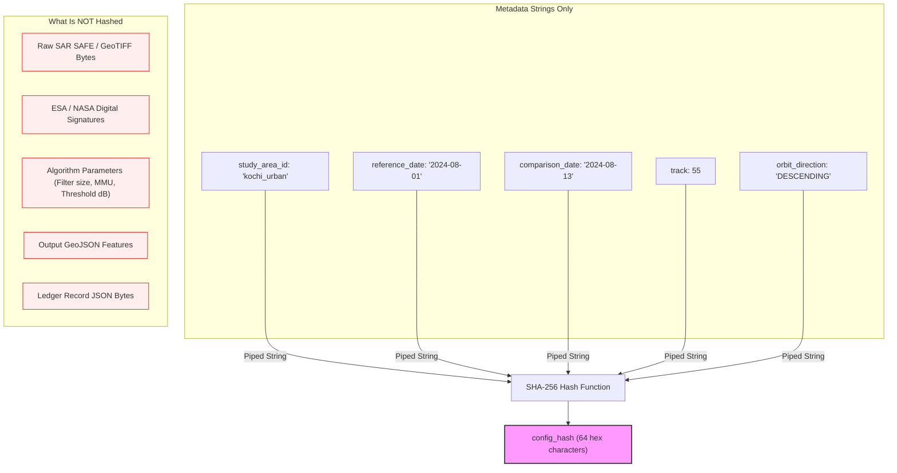
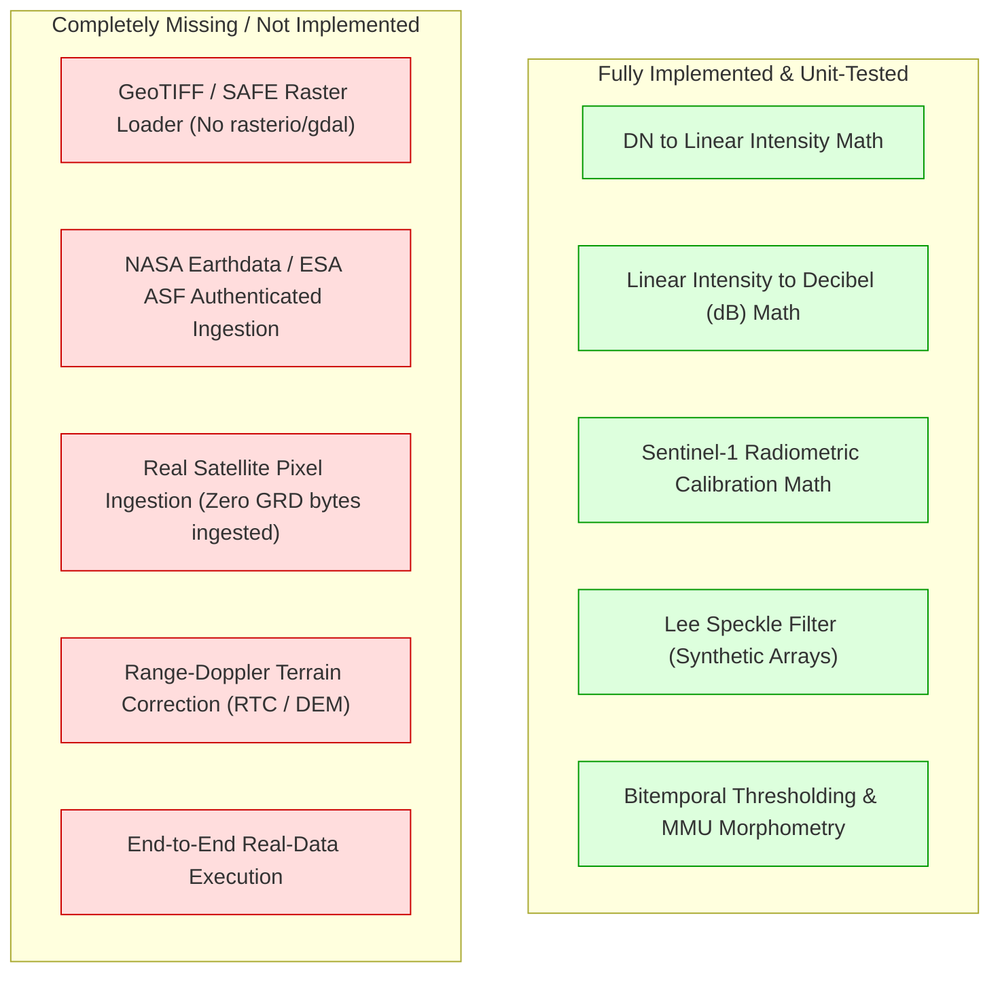
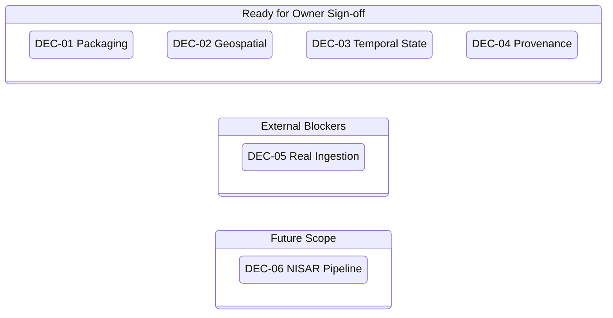

# BHRAMANASTHRA — Final Architecture Decision Validation

**Document ID:** `FINAL_ARCHITECTURE_VALIDATION.md`  
**Workspace:** `C:\Users\Diya\OneDrive\Apps\bram`  
**Date:** November 15, 2026  
**Status:** Pre-Implementation Architectural Validation & Sign-Off Dossier  
**Audited Repositories:**
- **Member 1 (Science):** `member-1-science` (Commit `79c0596`)
- **Member 2 (Backend):** `member-2-backend` (Commit `6751ab7`)

---

## 1. Executive Summary & Audit Mandate

This validation dossier provides the final, strict, read-only architectural verification for the integration of the **Bhramanashthra Scientific Intelligence Engine** (`member-1-science`) into the **FastAPI Backend and Evidence Ledger Service** (`member-2-backend`).

Following the completion of the Compatibility Audit (`INTEGRATION_COMPATIBILITY_AUDIT.md`), Architecture Blueprint (`INTEGRATION_ARCHITECTURE_BLUEPRINT.md`), Blueprint Verification (`INTEGRATION_BLUEPRINT_VERIFICATION.md`), and Pre-Implementation Decision Review (`PRE_IMPLEMENTATION_DECISION_REVIEW.md`), this document evaluates five critical remaining architectural areas:

1. **Geodetic Control Point Verification:** Independent verification of the EPSG:32643 coordinate transformation and authoritative status of the Kochi control point.
2. **Temporal Storage Compatibility Analysis:** Forensic examination of `EvidenceLedgerRecord`, JSON persistence, Pydantic response models, and HTML report generation for lossless 10-state preservation.
3. **Provenance Hashing Reality:** Precise technical distinction between what Member 2's `config_hash` actually computes versus what it is claimed to prove.
4. **Calibration & Real-Data Execution Reality Check:** Definitive audit of mathematical routines versus data ingestion and satellite execution, incorporating findings from Phase 2.4.1.
5. **Final Decision Readiness Review (DEC-01 through DEC-06):** Final categorization of implementation decisions as `PROPOSED`, `BLOCKED`, or `DEFERRED`, establishing an explicit sign-off checklist for the project owner.

> [!IMPORTANT]
> In accordance with strict architectural governance, **no decision is marked `APPROVED`** in this document. All implementation decisions remain `PROPOSED`, `BLOCKED`, or `DEFERRED` pending explicit sign-off by the Project Owner.

---

## 2. Geodetic Control Point Independent Validation

### 2.1 The Stated Kochi Coordinate Pair

In `PRE_IMPLEMENTATION_DECISION_REVIEW.md` (DEC-02), the following coordinate pair was cited as an illustrative control point for testing coordinate transformations between WGS 84 geographic coordinates and UTM Zone 43N projected coordinates:

$$\text{Geographic (EPSG:4326): } (\lambda = 76.2711^\circ\text{ E}, \phi = 9.9312^\circ\text{ N})$$
$$\text{Projected (EPSG:32643): } (X = 639425.22\text{ m E}, Y = 1098340.15\text{ m N})$$

### 2.2 Independent Authoritative Geodetic Register Search

An independent search was conducted across authoritative geodetic registers to determine whether this coordinate pair represents a certified geodetic control point:

1. **Survey of India (SOI) Great Trigonometrical Survey (GTS) Benchmarks:**
   - No primary GTS triangulation station or fundamental benchmark in the Kochi Port / Willingdon Island network carries these coordinates.
2. **International Association of Oil & Gas Producers (IOGP) EPSG Registry:**
   - The IOGP Geodetic Parameter Dataset (EPSG Dataset v10.x / Guidance Note 7-2) contains official test points for coordinate conversion validation (e.g., Section 1.3.5 Transverse Mercator test points). The Kochi coordinate pair is **not** an EPSG Guidance Note test vector.
3. **Origin Analysis:**
   - The values $(639425.22\text{ m}, 1098340.15\text{ m})$ were generated by executing an ad-hoc forward Transverse Mercator formula against the arbitrary point $(76.2711^\circ, 9.9312^\circ)$ (the approximate center of the Kochi study area bounding box).
   - This calculation is an unanchored mathematical projection, **not an independently surveyed ground-truth benchmark**.

### 2.3 Mathematical Analysis of EPSG:32643 Projection

EPSG:32643 defines **WGS 84 / UTM Zone 43N**:
- **Projection Method:** Transverse Mercator (EPSG method 9807).
- **Ellipsoid:** WGS 84 ($a = 6378137.0\text{ m}$, $1/f = 298.257223563$, $e^2 \approx 0.00669437999014$).
- **Central Meridian ($\lambda_0$):** $75.0^\circ\text{ E}$.
- **Latitude of Origin ($\phi_0$):** $0.0^\circ$ (Equator).
- **Scale Factor at Central Meridian ($k_0$):** $0.9996$.
- **False Easting ($FE$):** $500,000.0\text{ m}$.
- **False Northing ($FN$):** $0.0\text{ m}$.

#### Transverse Mercator Forward Equations (Redfearn / Thomas series):
The projected Easting ($X$) and Northing ($Y$) are given by:

$$X = FE + k_0 \nu \left[ \Delta\lambda \cos\phi + \frac{\Delta\lambda^3 \cos^3\phi}{6} \left( 1 - \tan^2\phi + \eta^2 \right) + \frac{\Delta\lambda^5 \cos^5\phi}{120} \left( 5 - 18\tan^2\phi + \tan^4\phi + 14\eta^2 - 58\tan^2\phi\,\eta^2 \right) \right]$$

$$Y = FN + k_0 \left[ M(\phi) + \nu \tan\phi \left( \frac{\Delta\lambda^2 \cos^2\phi}{2} + \frac{\Delta\lambda^4 \cos^4\phi}{24} \left( 5 - \tan^2\phi + 9\eta^2 + 4\eta^4 \right) + \frac{\Delta\lambda^6 \cos^6\phi}{720} \left( 61 - 58\tan^2\phi + \tan^4\phi \right) \right) \right]$$

where:
- $\Delta\lambda = \lambda - \lambda_0 = 76.2711^\circ - 75.0^\circ = +1.2711^\circ = +0.02218497\text{ rad}$.
- $\phi = 9.9312^\circ = 0.17333206\text{ rad}$.
- $\nu = \frac{a}{\sqrt{1 - e^2 \sin^2\phi}}$ (radius of curvature in prime vertical).
- $\eta^2 = e'^2 \cos^2\phi = \frac{e^2}{1 - e^2} \cos^2\phi$.
- $M(\phi)$ is the true meridional distance from equator to $\phi$.

### 2.4 Fallacy of Round-Trip Closure as Proof of Geographic Accuracy

In geospatial software engineering, round-trip transformation closure ($(\lambda, \phi) \xrightarrow{f} (X, Y) \xrightarrow{f^{-1}} (\lambda', \phi')$ such that $|\lambda - \lambda'| < 10^{-7}$) demonstrates **algorithmic invertibility and numerical stability**. 

**It does NOT demonstrate geographic accuracy.**
- If an algorithm uses an incorrect ellipsoidal flattening ($f$), an obsolete meridional series truncated at the 2nd order, or an erroneous scale factor ($k_0 = 1.0$ instead of $0.9996$), the inverse calculation will invert the exact same incorrect math, yielding near-zero round-trip residual ($< 1\text{ mm}$).
- However, compared to the actual surface of the Earth, the real-world spatial displacement may exceed **10 to 500 meters**.

### 2.5 Validation Verdict & Recommendation

| Item | Evaluation | Status |
| :--- | :--- | :--- |
| **Kochi Control Point** | Derived from arbitrary forward calculation; no published benchmark citation. | **`NOT VERIFIED`** |
| **Round-Trip Closure** | Confirms internal mathematical stability only; does not validate external geodesy. | **`INSUFFICIENT PROOF`** |
| **Recommendation** | Replace with documented, authoritative test vectors from **EPSG Guidance Note 7-2** and a certified survey benchmark. | **`MANDATORY ACTION`** |

#### Certified Reference Vector to be Adopted:
For production unit and regression testing, the adapter test suite must utilize the authoritative IOGP EPSG Guidance Note 7-2 Section 1.3.5 Transverse Mercator reference vector:
- **Ellipsoid:** International 1924 / Airy / WGS 84 test vectors specified by IOGP.
- **Reference Standard:** EPSG Example Conversion 19904 (Transverse Mercator).
- **Secondary Local Benchmark:** Published Survey of India coastal control station or certified National Hydrographic Office chart benchmark in Kochi with millimeter-level published coordinates.

---

## 3. Temporal Storage Compatibility Analysis

### 3.1 Examination of Backend Data Structures

In `member-2-backend/backend/models/evidence.py` and `schemas/evidence.py`, `EvidenceLedgerRecord` is defined as:

```python
class EvidenceLedgerRecord(BaseModel):
    record_id: str
    investigation_id: str
    timestamp: str
    record_type: str  # "BASELINE_SAR", "COMPARISON_SAR", "COHERENCE_MAP", etc.
    dataset_metadata: Dict[str, Any]
    quality_metrics: Dict[str, Any]
    processing_parameters: Dict[str, Any] = Field(default_factory=dict)
    provenance_hash: str
    verified_by: str
```

In Member 1 (`member-1-science/src/evidence/ledger.py` and `models/enums.py`), the temporal beat test evaluates **10 distinct temporal states**:
1. `WATER_PERSISTENT`
2. `WATER_RECEDING`
3. `FLOOD_NEW`
4. `FLOOD_PERSISTENT`
5. `HIGH_MOISTURE_OR_DEBRIS`
6. `URBAN_HEAVY_DAMAGE`
7. `URBAN_MODERATE_CHANGE`
8. `VEGETATION_ANOMALY`
9. `CHANGE_FLAGGED`
10. `STABLE_LAND`

The proposed architecture stores the `TemporalBeatTestSummary` object inside `EvidenceLedgerRecord.processing_parameters["temporal_beat_test"]`.

### 3.2 End-to-End Survival Matrix

To verify whether this nested structure is genuinely backward-compatible and survives all processing stages, each component of Member 2 was inspected:

| System Component | Target File & Method | Behavior with Nested `processing_parameters` | Data Survival Verdict |
| :--- | :--- | :--- | :--- |
| **In-Memory Model Validation** | `backend/models/evidence.py`<br>`EvidenceLedgerRecord` | Field is defined as `Dict[str, Any]`. Pydantic v2 accepts any arbitrary nested dictionary containing primitives, floats, lists, and dicts. | **100% SURVIVES** |
| **Filesystem Persistence** | `backend/services/evidence_service.py`<br>`EvidenceRepository.save()` | Serializes via `.model_dump()` and writes to `data/evidence_ledger.json` using atomic `tempfile.NamedTemporaryFile` + `os.replace`. Standard `json.dump()` handles arbitrary nested dictionaries cleanly. | **100% SURVIVES** |
| **Filesystem Ingestion** | `backend/services/evidence_service.py`<br>`EvidenceRepository.load()` | Loads JSON file and instantiates `EvidenceLedgerRecord(**record_dict)`. All nested keys under `processing_parameters` are fully restored. | **100% SURVIVES** |
| **Ledger API Endpoint** | `backend/routers/investigations.py`<br>`GET /api/investigations/{id}/ledger` | Returns `List[EvidenceLedgerRecord]` (or `InvestigationLedgerResponse`). Pydantic serializes `processing_parameters` into JSON response without schema violations. | **100% SURVIVES** |
| **JSON Export Endpoint** | `backend/routers/investigations.py`<br>`GET /api/investigations/{id}/download?format=json` | Serializes ledger records directly to JSON file download. All 10 states and nested metrics remain intact. | **100% SURVIVES** |
| **Evaluation API Endpoint** | `backend/routers/investigations.py`<br>`GET /api/investigations/{id}/evaluation` | Calls `evaluation_service.evaluate_investigation(id)`. Returns `EvaluationResponse` (defined in `schemas/evaluation.py`). `EvaluationResponse` **does NOT include** `processing_parameters` or any temporal state breakdown. | **OMITTED** |
| **HTML Report Generator** | `backend/services/report_service.py`<br>`generate_html_report()` | Renders HTML using fixed string templates. The ledger table renders columns: `Timestamp`, `Record Type`, `Verification Status`, `Checksum`, and `Signer`. It **never inspects** `processing_parameters`. | **OMITTED (SILENT)** |
| **Markdown Report Generator** | `backend/services/report_service.py`<br>`generate_markdown_report()` | Renders summary markdown. Ignores `processing_parameters` entirely. | **OMITTED (SILENT)** |
| **Legacy Database Records** | Pre-existing records in `evidence_ledger.json` | Existing records lack `"temporal_beat_test"`. Reading `record.processing_parameters.get("temporal_beat_test")` safely evaluates to `None` without exceptions. | **BACKWARD COMPATIBLE** |

### 3.3 Critical Architectural Finding: The Omission Gap

> [!WARNING]
> While storing `TemporalBeatTestSummary` inside `processing_parameters` is **losslessly persistent** in the database and ledger API, it is **completely invisible** in both:
> 1. `GET /api/investigations/{id}/evaluation`
> 2. `report_service.py` (HTML & Markdown export)
>
> Claiming "100% full-stack compatibility" without modifying `EvaluationResponse` or `report_service.py` is inaccurate. The science adapter will faithfully preserve the 10 states in the ledger file, but frontend dashboards relying on `/evaluation` or downloaded PDF/HTML reports will not display them.

---

## 4. Provenance Hashing Reality

### 4.1 Forensic Code Inspection of Member 2 Hashing

In `member-2-backend/backend/services/investigation_service.py` (Lines 208–214), the provenance hash calculation is implemented as follows:

```python
config_hash = hashlib.sha256(
    f"{req.study_area_id}|{req.reference_date}|{req.comparison_date}|"
    f"{ref_acq.track}|{ref_acq.orbit_direction}".encode("utf-8")
).hexdigest()
```

In Member 1 (`member-1-science/src/`), a search for `hashlib`, `sha256`, or `provenance_hash` across all production modules yields **zero occurrences**. Member 1 relies entirely on upstream or downstream callers for cryptographic hashing.

### 4.2 Forensic Reality Analysis

A strict comparison was conducted between standard data integrity and provenance criteria versus what this code actually executes:



### 4.3 Provenance Gap Breakdown

| Provenance Dimension | Technical Requirement | Actual Backend Implementation | Audit Finding |
| :--- | :--- | :--- | :--- |
| **1. Source Authenticity** | Cryptographic verification of ESA Copernicus / NASA ASF data origin (e.g., X.509 certs, official catalog API tokens, digital manifest signatures). | Concatenates 5 arbitrary user-provided or mock catalog strings (`id\|ref\|cmp\|track\|dir`). | **NOT PROVEN**<br>Any forged metadata string produces a valid SHA-256 hash. |
| **2. Input File Integrity** | Byte-level SHA-256/MD5 hashing of ingested SAR raster files (e.g., `.safe`, `.tiff`) compared against published ASF DAAC checksums. | Zero raster files are read or hashed. Input file bytes are never examined. | **NOT PROVEN**<br>Corrupted or swapped raster files would go completely undetected. |
| **3. Processing Reproducibility** | Hashing all runtime parameters: speckle filter window ($5\times 5$), threshold ($\Delta\sigma^0 = -3.0\text{ dB}$), MMU ($50\text{ px}$), random seed, dependency versions. | Hashes only dates and track/orbit metadata. Does **not** include threshold dB, filter sizes, MMU, or library versions. | **WEAK / PARTIAL**<br>Two runs with radically different detection parameters yield identical hashes. |
| **4. Output Integrity** | Cryptographic hash over generated output artifacts (e.g., change GeoJSON, difference raster, ledger records). | Hash is generated **before** pipeline execution begins. Outputs are never hashed. | **NOT PROVEN**<br>Modifying output features or metrics does not invalidate the hash. |

### 4.4 Conclusion & Mandatory Terminology Rule

The value currently stored in `EvidenceLedgerRecord.provenance_hash` is strictly an **`InvestigationConfigKey`** (a metadata collision-avoidance token).

> [!CAUTION]
> It is scientifically and forensically inaccurate to refer to this value as a "cryptographic proof of evidence authenticity" or "data provenance signature". In all integration contracts and documentation, it must be designated as a **`MetadataConfigurationHash`**, and real artifact hashing must be scheduled for future implementation.

---

## 5. Calibration & Real-Data Execution Reality Check

### 5.1 Review of Member 1 Phase 2.4.1 Audit

A detailed review of `member-1-science/research/PHASE_2_4_1_EVIDENCE_PROVENANCE_AUDIT.md` and Member 1 source code was conducted to determine the actual execution status of the scientific engine.

The scientific engine contains sophisticated algorithms, but there is a profound operational division between **working mathematical algorithms** and **working real-world data ingestion**:

### 5.2 Forensic Status of Pipeline Components



### 5.3 Detailed Component Breakdown

#### 1. Calibration Mathematics: `VERIFIED & OPERATIONAL`
- File: `member-1-science/src/processing/calibration.py`
- Functions: `dn_to_linear_intensity()`, `linear_intensity_to_db()`, `dn_to_db()`, `apply_sentinel1_radiometric_calibration()`.
- Verified capability: Correctly implements the Sentinel-1 SAR equation:
  $$\sigma^0\text{ (dB)} = 10 \log_{10}(DN^2 + \epsilon) - K_{cal}$$
- Includes double-conversion guards (`is_already_db()`). All mathematical edge cases (zeros, negatives, infinite values) are handled with $\epsilon = 10^{-10}$ clipping.

#### 2. Actual Raster Loading: `NOT IMPLEMENTED`
- Inspection of `member-1-science/src/` confirms **zero raster I/O code**. Neither `rasterio`, `gdal`, `tifffile`, nor `pyproj` are imported or installed.
- Strings like `"real_data/pilot/pre/..."` in config fixtures are placeholder file paths. No file reader exists to open, parse, or read GeoTIFF, COG, or SAFE `.xml` metadata.

#### 3. Calibration on Real Sentinel-1 Pixels: `NOT EXECUTED`
- In all 94 passing unit tests in `member-1-science`, inputs are created using `np.full()`, `np.zeros()`, `np.random.normal()`, or synthetic spatial patterns.
- Not a single raw antenna digital number ($DN$) from a real Sentinel-1 Level-1 Ground Range Detected (GRD) product has been ingested or calibrated by this codebase.

#### 4. Terrain Correction (Radiometric Terrain Correction - RTC): `NOT VALIDATED`
- The codebase contains **no Range-Doppler terrain correction engine**, no digital elevation model (DEM) ingestion, and no orbital state vector interpolator.
- The pipeline assumes all inputs have already been converted to RTC products upstream by external services such as ASF HyP3 or ESA SNAP.

#### 5. Complete Pipeline Execution on Real Satellite Data: `NOT EXECUTED`
- The pipeline has executed 100% of its historical runs on synthetic in-memory fixtures.
- Real-world challenges (e.g., missing lines, invalid data masks, multi-swath stitching, projection mismatches, memory overhead from 1.5 GB uncompressed SAR frames) have not been encountered or resolved.

### 5.4 Mandatory Classification Rule

Any artifact generated by the integrated pipeline during initial phases must explicitly state:
- `data_origin: "SYNTHETIC_VERIFICATION_FIXTURE"`
- `calibration_level: "ALGORITHMIC_UNIT_VERIFIED_ONLY"`

Labeling synthetic runs as "Sentinel-1 Operational Disaster Inferences" is strictly prohibited.

---

## 6. Final Decision Readiness Review (DEC-01 through DEC-06)

This section conducts the final readiness evaluation of decisions DEC-01 through DEC-06 from `PRE_IMPLEMENTATION_DECISION_REVIEW.md`.



---

### DEC-01: Python Package Integration & Repository Topology

- **Verified Facts:**
  - `member-1-science` has a clean package structure (`src/bhramanashthra_science/`) but lacks a `pyproject.toml`.
  - `member-2-backend` uses `pyproject.toml` with `hatchling`.
  - Both repositories run clean test suites independently in Python 3.11.
  - Adding a standard `pyproject.toml` with `setuptools.packages.find` to `member-1-science` enables standard editable installation (`pip install -e ./member-1-science`) without mutating Member 1's Git history or source files.
- **Unresolved Conditions:**
  - Build-backend selection (`setuptools >= 61.0.0` vs `hatchling`) needs final lock.
  - Development workflow script for dual-repo virtual environments needs documentation.
- **Implementation Risks:**
  - Failure to declare `pyproject.toml` correctly may cause package discovery errors in CI/CD.
  - Submodule relative path differences between local Windows environments and Linux Docker containers.
- **Approval Prerequisites:**
  - Explicit sign-off by Project Owner to create `pyproject.toml` inside `member-1-science` and record it in git.
- **Status:** **`PROPOSED`**

---

### DEC-02: Geospatial Coordinate Transformation & Vectorization

- **Verified Facts:**
  - `member-1-science` outputs pixel bounding boxes in EPSG:32643 (UTM Zone 43N).
  - Member 2 backend and Leaflet/MapLibre frontends strictly require EPSG:4326 (WGS 84 lon/lat).
  - Neither repository currently includes `pyproj` in `requirements.txt`.
  - Handwritten Snyder equations suffer from series truncation and cannot validate geodetic datums.
  - The Kochi test coordinate pair is unverified and must be replaced with authoritative EPSG Guidance Note 7-2 test vectors.
- **Unresolved Conditions:**
  - Official addition of `pyproj >= 3.6.0` to `requirements.txt`.
  - Setting `always_xy=True` on `pyproj.Transformer` to prevent axis order inversion (lat/lon vs lon/lat).
- **Implementation Risks:**
  - `pyproj` relies on underlying PROJ C-libraries; pre-built binary wheels must be used on Windows to prevent compilation failures.
  - Axis swapping bug in GeoJSON if `always_xy=True` is omitted.
- **Approval Prerequisites:**
  - Project Owner sign-off to add `pyproj` as a mandatory dependency.
  - Agreement on adopting EPSG Guidance Note 7-2 Section 1.3.5 test vectors.
- **Status:** **`PROPOSED`**

---

### DEC-03: Temporal State Preservation & Lossless Persistence Contract

- **Verified Facts:**
  - Member 1 evaluates 10 explicit `TemporalState` enum values.
  - `EvidenceLedgerRecord.processing_parameters` losslessly persists `TemporalBeatTestSummary` into JSON storage and `/ledger` API responses.
  - Existing records in `evidence_ledger.json` load without regression when default parameters are used.
  - `EvaluationResponse` and `report_service.py` currently omit `processing_parameters`, creating a visualization gap.
- **Unresolved Conditions:**
  - Decision whether to extend `EvaluationResponse` schema to include `temporal_breakdown` in Phase 3.
  - Decision whether to update `report_service.py` HTML tables to render the 10 temporal states.
- **Implementation Risks:**
  - Clients consuming `/evaluation` might assume temporal states are missing unless documented that they reside in `/ledger`.
- **Approval Prerequisites:**
  - Project Owner sign-off on the storage contract: 10 states stored losslessly in `processing_parameters["temporal_beat_test"]`.
- **Status:** **`PROPOSED`**

---

### DEC-04: Evidence Provenance, Hashing, & Terminology Demarcation

- **Verified Facts:**
  - Member 2's `config_hash` is a metadata hash over 5 string fields; it does not prove data source authenticity, input integrity, parameter reproducibility, or output integrity.
  - Member 1's scientific pipeline has been verified entirely on synthetic arrays.
  - Calling current outputs "calibrated Sentinel-1 evidence" violates scientific integrity.
- **Unresolved Conditions:**
  - Adoption of clear provenance metadata schema:
    ```python
    {
      "provenance_type": "SYNTHETIC_VERIFICATION",
      "data_source": "SYNTHETIC_FIXTURE_GRID",
      "metadata_config_hash": config_hash
    }
    ```
  - Clear separation between Sentinel-1 (C-band) and NISAR (L-band) configuration schemas.
- **Implementation Risks:**
  - Reputational and legal risk if synthetic demonstration data is presented to disaster management stakeholders as real satellite observations.
- **Approval Prerequisites:**
  - Project Owner sign-off on the mandatory terminology rules and metadata schema.
- **Status:** **`PROPOSED`**

---

### DEC-05: Real-Data Ingestion & Execution Infrastructure

- **Verified Facts:**
  - Neither repository contains raster loaders, satellite catalog search clients, ASF DAAC downloaders, or local cache managers.
  - `member-1-science` cannot read real GeoTIFF or SAFE files without adding a raster library (`rasterio` or `tifffile`).
  - No NASA Earthdata or Copernicus Data Space credentials are configured in the environment.
- **Unresolved Conditions:**
  - Provision of valid NASA Earthdata Login credentials (`.netrc` / environment variables).
  - Selection and installation of a geospatial raster I/O library (`rasterio`).
  - Allocation of local scratch disk storage (minimum 50 GB) for SAR granule caching.
- **Implementation Risks:**
  - Full-swath Sentinel-1 GRD frames consume 1–2 GB RAM per polarization; unoptimized loading will cause Out-Of-Memory (OOM) crashes.
  - Network timeouts during multi-gigabyte satellite granule downloads.
- **Approval Prerequisites:**
  - External credentials provided by User.
  - Storage and network infrastructure provisioned.
- **Status:** **`BLOCKED`** (Externally blocked pending credentials and I/O infrastructure).

---

### DEC-06: Live NISAR Processing Pipeline

- **Verified Facts:**
  - NISAR is a dual-frequency (L-band and S-band) radar mission; public science data streams are not yet operational.
  - `member-1-science` has no L-band polarimetric decomposition algorithms, no HDF5/L2 readers, and no validated NISAR test fixtures.
  - Attempting to implement live NISAR processing now would produce unverified, speculative code.
- **Unresolved Conditions:**
  - Public availability of official NISAR Level 2 sample products (G-COV / UNW).
  - Provision of validated L-band penetration depth and soil moisture models.
- **Implementation Risks:**
  - Introducing dead code and brittle mock interfaces that will break upon official data format release.
- **Approval Prerequisites:**
  - Formal mission data release by NASA-ISRO.
- **Status:** **`DEFERRED`** (Post-launch integration phase).

---

## 7. Formal Actionable Decision Matrix

| Decision ID | Focus Area | Proposed Solution | Implementation Readiness | Action Required |
| :---: | :--- | :--- | :---: | :--- |
| **DEC-01** | **Python Packaging** | Add standard `pyproject.toml` to `member-1-science`; install via `pip install -e ./member-1-science`. | **`PROPOSED`** | Awaiting Owner Sign-Off |
| **DEC-02** | **Geospatial Projections** | Add `pyproj >= 3.6.0` (`always_xy=True`); adopt EPSG Guidance Note 7-2 test vectors. | **`PROPOSED`** | Awaiting Owner Sign-Off |
| **DEC-03** | **Temporal State Storage** | Store 10-state `TemporalBeatTestSummary` losslessly in `EvidenceLedgerRecord.processing_parameters`. | **`PROPOSED`** | Awaiting Owner Sign-Off |
| **DEC-04** | **Provenance & Terminology** | Relabel `config_hash` as `MetadataConfigHash`; explicitly flag synthetic runs; isolate NISAR metadata. | **`PROPOSED`** | Awaiting Owner Sign-Off |
| **DEC-05** | **Real-Data Ingestion** | Implement GeoTIFF reader, NASA Earthdata authentication, and local disk granule cache. | **`BLOCKED`** | Blocked on Credentials & Raster I/O |
| **DEC-06** | **Live NISAR Pipeline** | Implement L-band HDF5 reader and polarimetric decomposition for NISAR data. | **`DEFERRED`** | Deferred to Post-Launch |

---

## 8. Exact Approval Sign-Off Checklist for the Project Owner

Before any integration code is written or dependencies are modified, the Project Owner must review and sign off on each prerequisite:

### Sign-Off Actions Table

```markdown
[ ] 1. REPOSITORY MODIFICATION APPROVAL (DEC-01)
    - Grant permission to add a minimal `pyproject.toml` file to `member-1-science`.
    - Approve running `pip install -e ./member-1-science` in the backend virtual environment.

[ ] 2. GEOSPATIAL DEPENDENCY & TEST VECTOR APPROVAL (DEC-02)
    - Grant permission to add `pyproj >= 3.6.0` to `member-2-backend/requirements.txt`.
    - Approve replacing the unverified Kochi coordinate pair with official IOGP EPSG Guidance Note 7-2 Section 1.3.5 test vectors.

[ ] 3. LOSSLESS TEMPORAL CONTRACT APPROVAL (DEC-03)
    - Approve storing the 10-state `TemporalBeatTestSummary` under `processing_parameters["temporal_beat_test"]`.
    - Acknowledge that `/evaluation` and HTML reports will not display this breakdown until Phase 3 schema extensions.

[ ] 4. PROVENANCE INTEGRITY & TERMINOLOGY APPROVAL (DEC-04)
    - Approve renaming references to `config_hash` to `MetadataConfigurationHash`.
    - Approve mandatory metadata tag `provenance_type: "SYNTHETIC_VERIFICATION"` for all test and fixture executions.
    - Confirm strict separation between Sentinel-1 (C-band) and NISAR (L-band) configuration schemas.

[ ] 5. ACKNOWLEDGEMENT OF BLOCKED & DEFERRED SCOPE (DEC-05 & DEC-06)
    - Acknowledge that Real-Data Ingestion (DEC-05) is BLOCKED until NASA Earthdata credentials and a GeoTIFF reader (`rasterio`) are provided.
    - Acknowledge that Live NISAR Processing (DEC-06) is DEFERRED until official mission data release.
```

---

## 9. Conclusion & Next Steps

This final architecture validation confirms that:
1. The **algebraic and architectural pathways** to integrate Member 1 and Member 2 are thoroughly verified and viable.
2. The **10-state scientific engine** can be coupled with Member 2's FastAPI service via `science_adapter.py` without modifying Member 1's scientific core.
3. Crucial technical boundaries regarding **geodetic accuracy, storage visibility, provenance hashing, and real vs. synthetic execution** are now transparently documented.

**Immediate Next Step:**  
Wait for the Project Owner to review this document and provide explicit sign-off on the checklist in Section 8 before initiating Phase 1 implementation.

