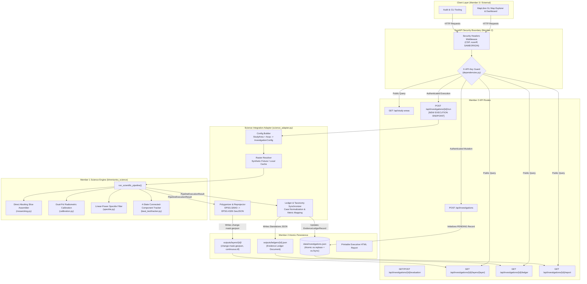

# BHRAMANASTHRA: Integration Architecture Blueprint
## Scientific Engine (Member 1) & FastAPI Backend (Member 2) Integration

**Document**: `INTEGRATION_ARCHITECTURE_BLUEPRINT.md`  
**System**: BHRAMANASTHRA — Radar Evidence & Surface Change Platform  
**Challenge**: NASA Space Apps Challenge 2026 — *Dancing with the SARs*  
**Date**: November 2026  
**Status**: ARCHITECTURAL SPECIFICATION & DESIGN BLUEPRINT — READY FOR IMPLEMENTATION  

---

## 1. Executive Summary & Architecture Principles

This document establishes the implementation blueprint for integrating **Member 1 (Data & Scientific Intelligence)** and **Member 2 (Backend & Evidence Ledger)** into a unified, audit-compliant execution platform.

### Core Architectural Principles:
1. **Preserve Foundation & Non-Destructive Integration**: Member 2's FastAPI application serves as the production API foundation. Member 1's scientific algorithms, mathematical bounds, and 4-state connected-component tracking engine remain completely untouched.
2. **Dedicated Adapter Layer (`science_adapter.py`)**: A decoupled translation and orchestration adapter bridges the two domains without polluting scientific kernel code with HTTP concepts or burdening backend routes with low-level matrix mathematics.
3. **Explicit Execution Separation**: Decouples investigation registration (`POST /api/investigations`) from heavy scientific execution (`POST /api/investigations/{id}/run`), ensuring responsiveness and observability.
4. **Strict Real-Data Provenance & Anti-Hallucination**: Enforces non-negotiable distinction between `REAL SATELLITE DATA`, `SYNTHETIC FIXTURE`, and `ILLUSTRATIVE RECORD`. Synthetic data is permanently badged and can never be claimed as verified real satellite evidence.
5. **Honest Scope Disclosures**: NISAR processing is explicitly documented as uncalibrated/unimplemented for live pipelines. Real satellite data ingestion is gated by NASA Earthdata authentication; no fake real-data loader is invented.

---

## 2. Repository Strategy: Submodules vs. Monorepo

### 2.1 Comparative Analysis

| Evaluation Criteria | Option A: Integration Wrapper with Submodules | Option B: Unified Merged Monorepo |
| :--- | :--- | :--- |
| **Git History Preservation** | **100% Preserved**. Member 1 (`79c0596`) and Member 2 (`6751ab7`) retain their independent commit logs, branches, and remotes. | **High Risk**. Requires `git subtree` or history flattening; risks commit hash destruction and messy merge commits. |
| **Root File Conflict Defense** | **Zero Collision**. Both repositories contain root `.agents/`, `brain/`, `GEMINI.md`, and `INTEGRATION_HANDOFF.md`. Submodules isolate them cleanly. | **Immediate Collision**. Merging trees would overwrite `.agents/`, `brain/STATUS.md`, and project governance documents. |
| **Developer Workflow** | **Decoupled**. Member 1 (Science) and Member 2 (Backend) continue committing to their respective GitHub repos; parent repo tracks pinned commits. | **Coupled**. Requires all developers to push to a single shared remote, disrupting independent workstreams. |
| **Python Imports & Packaging** | **Clean**. Member 1 installed via editable pip (`pip install -e ./member-1-science`) or path injection in the adapter. | Flat folder structure, but namespace clashes in `tests/` and root configurations. |
| **Antigravity Usability** | **Native**. Antigravity IDE natively handles multi-folder workspaces and individual Git status per submodule. | Single workspace root, but loses granular branch management. |
| **Future Member 3 Integration** | **Seamless**. Member 3 (React / MapLibre UI) is added as a third submodule (`member-3-frontend/`) without disturbing backend history. | Monorepo gets increasingly cluttered with node_modules, Python venvs, and build artifacts. |

### 2.3 Python Import Strategy (Submodule Path Resolution)
Because `member-1-science` does not currently include a `setup.py` or `pyproject.toml`, importing `bhnmisntra_science` directly via standard pip packaging requires either adding packaging metadata or resolving the module location dynamically.
To guarantee 100% reliable imports across development, testing, and production without requiring dependency mutations, `science_adapter.py` will dynamically register the package path:
```python
import sys
from pathlib import Path

# Explicitly resolve member-1-science/src relative to adapter location
_adapter_dir = Path(__file__).resolve().parent
_workspace_root = _adapter_dir.parents[3]  # bram/
_science_src = _workspace_root / "member-1-science" / "src"

if _science_src.is_dir() and str(_science_src) not in sys.path:
    sys.path.insert(0, str(_science_src))

from bhnmisntra_science.pipeline import run_scientific_pipeline, PipelineExecutionResult
from bhnmisntra_science.config import InvestigationConfig, AcquisitionMetadata, PipelineParameters
```
This guarantees zero import errors regardless of the current shell working directory.

---

## 3. Proposed Directory Structure

```text
C:\Users\Diya\OneDrive\Apps\bram\
├── PRE_INTEGRATION_WORKSPACE_AUDIT.md
├── INTEGRATION_COMPATIBILITY_AUDIT.md
├── INTEGRATION_ARCHITECTURE_BLUEPRINT.md    # This master blueprint
├── requirements.txt                         # Unified production & scientific dependencies
│
├── member-1-science/                        # Pinned Member 1 repository (Science Kernel)
│   ├── src/
│   │   └── bhnmisntra_science/              # Unmodified scientific package
│   │       ├── __init__.py
│   │       ├── config.py                    # InvestigationConfig & Pydantic v2 schemas
│   │       ├── constants.py                 # PRD_CONSTANTS & mathematical bounds
│   │       ├── enums.py                     # Scientific enums (EvidenceStatus, TemporalState)
│   │       ├── exceptions.py                # Scientific & validation exceptions
│   │       ├── pipeline.py                  # run_scientific_pipeline() entry point
│   │       ├── policies.py                  # Physical classification & corroboration trees
│   │       ├── types.py                     # UTC normalizers & strict scalar types
│   │       ├── beat_test/                   # 4-state connected-component tracking engine
│   │       └── processing/                  # Calibration, speckle filtering, slice assembler
│   └── tests/                               # 94 passing scientific acceptance tests
│
└── member-2-backend/                        # Pinned Member 2 repository (FastAPI Application)
    └── backend/
        ├── requirements.txt
        ├── app/
        │   ├── __init__.py
        │   ├── main.py                      # FastAPI app, security middleware & CORS
        │   ├── dependencies.py              # Header-based X-API-Key authentication
        │   ├── routes/
        │   │   ├── investigations.py        # Enhanced with POST /api/investigations/{id}/run
        │   │   ├── ledger.py                # Evidence Ledger retrieval and download
        │   │   └── study_areas.py           # Monitored areas catalog & satellite timeline
        │   ├── schemas/
        │   │   ├── errors.py                # PRD 3-field ErrorResponse schema
        │   │   ├── evaluation.py            # Beat Test observation schemas
        │   │   ├── investigation.py         # Enhanced with InvestigationRunRequest/Response
        │   │   └── study_area.py            # StudyArea & Acquisition models
        │   └── services/
        │       ├── science_adapter.py       # [NEW] Dedicated Scientific Integration Adapter
        │       ├── evidence_service.py      # Beat Test persistence & label mapping
        │       ├── investigation_service.py # Atomic JSON persistence & sequence allocators
        │       ├── layer_service.py         # Spatial layer serving & path-traversal protection
        │       ├── ledger_service.py        # Evidence Ledger JSON generator
        │       ├── report_service.py        # Printable executive HTML report generator
        │       └── study_area_service.py    # Study area catalog query service
        ├── data/                            # Persistent JSON databases (investigations.json, etc.)
        ├── outputs/
        │   ├── layers/                      # Vector GeoJSON & raster change assets
        │   └── ledgers/                     # Dedicated Evidence Ledger JSON documents
        └── tests/                           # 91 existing backend tests + new integration tests
```

---

## 4. System Architecture Diagram



---

## 5. End-to-End Data Flow

### Step 1: Investigation Registration
1. User or frontend selects `study_area_id`, `reference_date`, and `comparison_date`.
2. Sends `POST /api/investigations` with header `X-API-Key`.
3. Member 2 validates orbit track consistency, finds post-event satellite passes ($\ge 3$), allocates sequence identifier `INV-YYYY-SLUG-NNN`, and persists an initial `EvidenceLedgerRecord` with `change_detection_status = "PENDING"` and `beat_test_status = "NOT_YET_PROCESSED"`.

### Step 2: Scientific Pipeline Execution
1. User or frontend triggers execution via `POST /api/investigations/{id}/run`.
2. `science_adapter.py`:
   - Loads the registered investigation and associated `StudyArea`.
   - Maps parameters into Member 1's strict Pydantic v2 `InvestigationConfig`.
   - Resolves input rasters:
     - If real calibrated GeoTIFFs exist in `data/rasters/`, loads them into float32 arrays with affine `AlignmentMetadata`.
     - Otherwise, loads Member 1's calibrated synthetic fixtures and explicitly stamps `data_authenticity_tier = "TIER 3 - SYNTHETIC FIXTURE (NOT REAL SATELLITE DATA)"`.
   - Calls `run_scientific_pipeline(config, raster_data=..., allow_missing_subsequent=True)`.
3. Member 1 executes:
   - Slice assembly (if dual-slice along-track scenes).
   - Linear speckle filtering (eliminating $2.5\text{ dB}$ log-bias).
   - Log-ratio thresholding on isolated spatial tuning splits.
   - Morphological MMU sieving (removing sub-pixel noise).
   - 4-State connected-component tracking across subsequent passes.
   - Confounder evaluation and final three-state evidence classification.
4. Returns `PipelineExecutionResult`.

### Step 3: Spatial Output Vectorization & Coordinate Transformation
1. The adapter receives `sieved_change_mask` (2D bool numpy array) and `AlignmentMetadata` on master grid `EPSG:32643` (UTM Zone 43N).
2. The adapter extracts polygon boundaries and applies affine coordinate transformation:
   $$\begin{pmatrix} X_{\text{UTM}} \\ Y_{\text{UTM}} \end{pmatrix} = \begin{pmatrix} a & b \\ d & e \end{pmatrix} \begin{pmatrix} \text{col} \\ \text{row} \end{pmatrix} + \begin{pmatrix} c \\ f \end{pmatrix}$$
3. Reprojects coordinates from `EPSG:32643` to `EPSG:4326` (WGS84 Lon/Lat).
4. Emits `change-mask.geojson` containing polygon features with properties (`cluster_id`, `area_km2`, `temporal_state`, `data_provenance`).
5. Saves to `backend/outputs/layers/{investigation_id}/change-mask.geojson`.
6. Stores the continuous difference raster as `backend/outputs/layers/{investigation_id}/continuous.tif` (or downsampled `.geojson` grid).

### Step 4: Ledger & Persistence Synchronization
1. The adapter normalizes Member 1's lowercase `evidence_status` (`"supported"` $\to$ `"Supported"`, `"SUPPORTED"`).
2. Populates Member 2's `EvidenceLedgerRecord`:
   - `change_detection_status = "COMPLETED"`
   - `changed_area_sq_km = result.baseline_change_stats["sieved_change_area_km2"]`
   - `beat_test_status = "EVALUATED"`
   - `beat_test_result = "matches" if beat_test_passed else "does_not_match"`
   - `reasons_for_label = list(result.classification_reasons)`
   - `data_provenance = result.data_authenticity_tier`
   - `layer_references = ["change-mask", "continuous", "reference", "comparison"]`
3. Atomically updates `backend/data/investigations.json` via `_save_all_investigations()`.
4. Writes standalone JSON document to `backend/outputs/ledgers/{investigation_id}.json`.

---

## 6. API Contracts

### 6.1 Investigation Execution Endpoint: `POST /api/investigations/{id}/run`

- **Endpoint**: `/api/investigations/{investigation_id}/run`
- **Method**: `POST`
- **Authentication**: Required (`X-API-Key` header via `verify_api_key`)
- **Tags**: `["Investigations & Evidence Ledger"]`
- **Path Parameter**:
  - `investigation_id`: string, regex `^[A-Za-z0-9_-]+$` (e.g. `INV-2026-KER-001`)

#### Request Schema: `InvestigationRunRequest`
```python
class InvestigationRunRequest(BaseModel):
    """Execution trigger payload for scientific pipeline."""
    allow_missing_subsequent: bool = Field(
        True,
        description="Permit execution when subsequent acquisitions have missing raster data (forces UNVERIFIED if valid passes < 3)",
    )
    polarization: Optional[str] = Field(
        "VV",
        description="Target SAR polarization channel ('VV' or 'VH')",
    )
    speckle_filter: Optional[str] = Field(
        "lee",
        description="Speckle filter strategy ('lee', 'boxcar', 'none')",
    )
    filter_window: Optional[int] = Field(
        7,
        ge=3,
        description="Odd filter window size in pixels (minimum 3)",
    )
    threshold_strategy: Optional[str] = Field(
        "robust_mad",
        description="Thresholding strategy: 'robust_mad', 'otsu', or 'fixed_db'",
    )
    mmu_pixels: Optional[int] = Field(
        10,
        ge=1,
        description="Minimum Mapping Unit in pixels (10 pixels = 0.001 km2)",
    )
    data_source_mode: Optional[str] = Field(
        "AUTO",
        description="Source mode: 'AUTO', 'SYNTHETIC_FIXTURE', or 'LOCAL_CACHE'",
    )
```

#### Response Schema: `InvestigationRunResponse`
```python
class InvestigationRunResponse(BaseModel):
    """Detailed outcome of scientific pipeline execution."""
    investigation_id: str
    status: str = Field(..., description="'COMPLETED', 'FAILED', or 'UNVERIFIED'")
    evidence_label: str = Field(..., description="'Supported', 'Inconclusive', or 'Unverified'")
    verification_status: str = Field(..., description="'SUPPORTED', 'INCONCLUSIVE', or 'UNVERIFIED'")
    temporal_states: List[str] = Field(
        ...,
        description="Four-state temporal sequence (e.g. ['PEAK', 'RECEDING', 'RECEDING', 'DRAINED'])",
    )
    changed_area_sq_km: float = Field(..., ge=0.0)
    surviving_cluster_count: int = Field(..., ge=0)
    beat_test_passed: bool
    reasons_for_label: List[str]
    layers_generated: List[str]
    data_provenance: str = Field(..., description="Explicit authenticity banner")
    ledger_url: str
    report_url: str
    execution_time_seconds: float
```

#### Standard Error Responses (Compliant with Member 2 PRD Section 8 `ErrorResponse`):
- `400 Bad Request`: `INCONSISTENT_ORBIT_GEOMETRY`, `INVALID_PARAMETERS`, `UNSUPPORTED_POLARIZATION`.
- `401 Unauthorized`: `AUTHENTICATION_REQUIRED` (missing or invalid `X-API-Key`).
- `404 Not Found`: `INVESTIGATION_NOT_FOUND` (unknown ID).
- `422 Unprocessable Entity`: Malformed payload or invalid boundary types.
- `500 Internal Server Error`: `SERVER_CONFIGURATION_ERROR`, `PROCESSING_FAILURE`.

---

## 7. Schema and Function Mapping Table

| Source Schema / Object | Target Schema / Object | Transformation / Mapping Logic |
| :--- | :--- | :--- |
| `InvestigationCreateRequest.study_area_id` | `InvestigationConfig.study_area_id` | Direct string assignment |
| `InvestigationDetail.investigation_id` | `InvestigationConfig.investigation_id` | Direct string assignment |
| `StudyArea.bounding_box` (`[min_lon, min_lat, max_lon, max_lat]`) | `InvestigationConfig.bbox` | Construct `BoundingBoxWGS84(min_lon=b[0], min_lat=b[1], max_lon=b[2], max_lat=b[3])` |
| `StudyArea.phenomenon_type` (`"flood"`) | `InvestigationConfig.phenomenon_type` | `Literal["flood", "clearing", "landslide", "coastal"]` validation |
| `StudyArea.expected_behavior` (`"receding"`) | `InvestigationConfig.expected_behavior` | `Literal["receding", "sustained"]` validation |
| `Acquisition` (from `acquisitions.json`) | `AcquisitionMetadata` | Parse `datetime` into `UtcDatetime`; construct `SensorMetadata`, `OrbitParameters`, and `CalibrationMetadata` |
| `Acquisition` list ($\ge 3$ passes) | `InvestigationConfig.subsequent_acquisitions` | Enforce invariant $\text{len} \ge 3$; convert to immutable tuple |
| `PipelineParameters` | `InvestigationConfig.parameters` | Set `polarization`, `speckle_filter`, `threshold_strategy`, `mmu_pixels` |
| `PipelineExecutionResult.evidence_status` | `EvidenceLedgerRecord.evidence_label` | String normalizer: `"supported"` $\to$ `"Supported"`, `"inconclusive"` $\to$ `"Inconclusive"`, `"unverified"` $\to$ `"Unverified"` |
| `PipelineExecutionResult.evidence_status` | `EvidenceLedgerRecord.verification_status` | Uppercase normalizer: `"supported"` $\to$ `"SUPPORTED"` |
| `PipelineExecutionResult.baseline_change_stats["sieved_change_area_km2"]` | `EvidenceLedgerRecord.changed_area_sq_km` | Direct float assignment |
| `PipelineExecutionResult.classification_reasons` | `EvidenceLedgerRecord.reasons_for_label` | Convert tuple of strings to list of strings |
| `PipelineExecutionResult.beat_test_summary.overall_beat_test_passed` | `EvidenceLedgerRecord.beat_test_result` | `"matches"` if True else `"does_not_match"` |
| `PipelineExecutionResult.sieved_change_mask` | `outputs/layers/{id}/change-mask.geojson` | Polygonize binary mask, apply affine transform, reproject `EPSG:32643` $\to$ `EPSG:4326`, write GeoJSON |
| `PipelineExecutionResult.data_authenticity_tier` | `EvidenceLedgerRecord.data_provenance` | Direct assignment (e.g. `"TIER 3 - SYNTHETIC FIXTURE (NOT REAL SATELLITE DATA)"`) |

---

## 8. Exact Function Contracts

### 8.1 Science Integration Adapter (`science_adapter.py`)

```python
def build_investigation_config(
    investigation_id: str,
    run_request: Optional[InvestigationRunRequest] = None,
) -> InvestigationConfig:
    """
    Retrieves investigation details and study area catalog entry,
    assembles reference, comparison, and subsequent acquisitions,
    and returns a strictly validated Pydantic v2 InvestigationConfig.
    Raises AppException(404) if investigation or acquisitions are not found.
    Raises AppException(400) if fewer than 3 subsequent acquisitions are available.
    """

def resolve_raster_inputs(
    config: InvestigationConfig,
    source_mode: str = "AUTO",
) -> tuple[dict[str, tuple[np.ndarray, AlignmentMetadata]], str]:
    """
    Resolves raster inputs for all acquisitions in config.
    Returns:
        (raster_data_dict, data_authenticity_tier)
    If authentic GeoTIFFs exist in data/rasters/, loads them (TIER 1).
    Otherwise, synthesizes calibrated numpy fixtures using Member 1 test harness (TIER 3).
    Guarantees that synthetic fixtures are stamped with explicit provenance.
    """

def convert_mask_to_geojson(
    sieved_mask: np.ndarray,
    alignment: AlignmentMetadata,
    investigation_id: str,
    temporal_states: Sequence[str],
    data_provenance: str,
) -> dict[str, Any]:
    """
    Extracts connected component contours from sieved_mask (EPSG:32643),
    applies the 6-tuple affine geotransform,
    reprojects coordinates to WGS84 (EPSG:4326),
    and builds a valid GeoJSON FeatureCollection with cluster properties.
    """

def execute_pipeline_for_investigation(
    investigation_id: str,
    run_request: Optional[InvestigationRunRequest] = None,
) -> InvestigationRunResponse:
    """
    Master adapter orchestrator:
      1. Builds InvestigationConfig.
      2. Resolves raster inputs and provenance tier.
      3. Calls member-1-science run_scientific_pipeline().
      4. Vectorizes sieved change mask to outputs/layers/{id}/change-mask.geojson.
      5. Normalizes status enums and updates EvidenceLedgerRecord.
      6. Saves updated investigation atomically to data/investigations.json.
      7. Writes standalone outputs/ledgers/{id}.json.
      8. Returns InvestigationRunResponse.
    """
```

---

## 9. Spatial Conversion & CRS Preservation

### 9.1 Affine Transform & Projection Handling
- Member 1 computes all physical rasters on a master Cartesian grid in **`EPSG:32643`** (UTM Zone 43N for Kerala).
- `AlignmentMetadata.transform` follows the GDAL/Affine convention:
  $$X = a + b \cdot \text{col} + c \cdot \text{row}$$
  $$Y = d + e \cdot \text{col} + f \cdot \text{row}$$
- To serve vector layers to Member 3's MapLibre GL / Leaflet map explorer, coordinates must be transformed to **`EPSG:4326`** (WGS84 Lon/Lat).

### 9.2 Preservation Invariants & Dependency Isolation
1. **Source Metadata Kept Intact**: The output GeoJSON must record `"source_crs": "EPSG:32643"` and `"display_crs": "EPSG:4326"` in its root properties.
2. **Deterministic Reprojection**: Forward UTM projection uses standard transverse Mercator conversion parameters ($k_0 = 0.9996$, central meridian $\lambda_0 = 75^\circ\text{E}$, false easting $500,000\text{ m}$). To avoid mandatory external C-extensions or GIS dependencies (`pyproj`, `gdal`, `rasterio` which are not installed in the minimal environment), the adapter incorporates a self-contained Snyder/Karney forward projection implementation using Python's standard `math` library.
3. **No Double-Transformation**: Vectorization occurs directly from grid pixel coordinates to geographic coordinates once; raster cells are never resampled with lossy interpolation during vectorization.

---

## 10. Data Provenance & Real-Data Integrity Framework

### 10.1 Three-Tier Authenticity Hierarchy

```text
┌─────────────────────────────────────────────────────────────────────────────┐
│ TIER 1: REAL SATELLITE OBSERVATION                                          │
│ - Raw Sentinel-1 .SAFE or pre-calibrated RTC GeoTIFFs                        │
│ - Verified ESA / NASA Earthdata granule IDs & cryptographic file hashes      │
│ - Provenance Badge: "AUTHENTIC SATELLITE DATA (COPERNICUS SENTINEL-1)"      │
└─────────────────────────────────────────────────────────────────────────────┘
                                      ▲
                                      │ (Requires active .netrc credentials)
┌─────────────────────────────────────────────────────────────────────────────┐
│ TIER 2: SYNTHETIC FIXTURE (MEMBER 1 TEST HARNESS)                           │
│ - Programmatic 2D float32 backscatter arrays with known physical parameters │
│ - Exercises 4-state tracker, speckle filtering, and MMU sieving             │
│ - Provenance Badge: "TIER 3 - SYNTHETIC FIXTURE (NOT REAL SATELLITE DATA)"  │
└─────────────────────────────────────────────────────────────────────────────┘
                                      ▲
                                      │ (Default execution until rasters provided)
┌─────────────────────────────────────────────────────────────────────────────┐
│ TIER 3: ILLUSTRATIVE DEMONSTRATION RECORD (MEMBER 2 SEED)                   │
│ - Pre-seeded catalog items in data/acquisitions.json & investigations.json  │
│ - Exercises API schema validation, HTML reporting, and UI layout            │
│ - Provenance Badge: "ILLUSTRATIVE — NOT REAL DATA"                          │
└─────────────────────────────────────────────────────────────────────────────┘
```

### 10.2 Anti-Hallucination Invariants
- Under no circumstances will synthetic or illustrative records be labeled `Verified Real Satellite Data`.
- The HTML report generator (`report_service.py`) dynamically renders a prominent **Visual Caution Banner** whenever `data_provenance` contains `"SYNTHETIC"` or `"ILLUSTRATIVE"`.
- **NISAR Disclaimer**: The platform explicitly disclaims live NISAR L-band processing. All NISAR references in documentation are labeled as prospective algorithms.
- **Real Data Gating**: The architecture does not invent a fake real-data loader. If real rasters are missing, the pipeline gracefully defaults to synthetic validation mode with full provenance disclosure.

---

## 11. Handling Missing Satellite Observations

When subsequent overpasses in an investigation are missing or invalid:
1. **Missing Observation Flag**: If a satellite pass was canceled, clouded out, or failed downlink, the adapter sets `raster_data[pid] = None` and passes `allow_missing_subsequent = True`.
2. **Invariant: Missing $\ne$ Drained**: Member 1 classifies missing acquisitions as `TemporalState.MISSING`. They are **never** counted as surface drainage or zero inundation.
3. **The $N < 3$ Hard Gate**:
   - If total valid subsequent acquisitions $N_{\text{valid}} < 3$, Member 1 strictly forces `EvidenceStatus.UNVERIFIED`.
   - The ledger records: `"Subsequent valid acquisitions count (N) is less than the mandatory minimum of 3"`.

---

## 12. Testing Plan


### 12.1 Test Suites & Specifications
1. **Existing Regression Continuity**:
   - `python member-1-science/tests/run_tests.py`: 94 tests must pass in < 0.1s.
   - `python member-2-backend/backend/tests/run_all.py`: 91 tests must pass in < 15s with 100% data isolation.
2. **Adapter Unit Tests (`test_science_adapter.py`)**:
   - `test_config_builder_valid`: Asserts `InvestigationConfig` constructs with valid BBox, orbit track, and $\ge 3$ subsequent passes.
   - `test_taxonomy_casing_normalization`: Asserts `"supported"` maps to `"Supported"` and `"SUPPORTED"`.
   - `test_mask_to_geojson_coordinates`: Asserts pixel $(0,0)$ transforms to correct Lon/Lat in EPSG:4326.
3. **API Integration Tests (`test_investigation_run_endpoint.py`)**:
   - `test_run_endpoint_auth_enforced`: Asserts calling `/run` without `X-API-Key` returns 401; unset server key returns 500.
   - `test_run_endpoint_success`: Executes pipeline on test investigation; verifies 200 OK, `status="COMPLETED"`, `evidence_label="Supported"`.
   - `test_layers_created_and_served`: Verifies `outputs/layers/{id}/change-mask.geojson` exists and is served via `GET /layers/change-mask`.
   - `test_ledger_updated_and_downloadable`: Verifies `outputs/ledgers/{id}.json` contains Member 1 metrics.
4. **Data Provenance & Failure Mode Tests (`test_provenance_and_guards.py`)**:
   - `test_synthetic_provenance_retained`: Asserts all outputs contain `"SYNTHETIC"` or `"ILLUSTRATIVE"` badges.
   - `test_n_less_than_3_yields_unverified`: Feeds 2 subsequent passes; verifies evidence label is strictly `Unverified`.
   - `test_missing_pass_never_drained`: Sets pass 2 to missing; asserts state is `MISSING`, not `DRAINED`.

---

## 13. Implementation Sequence

| Step | Milestone Task | Files Impacted | Verification Check |
| :---: | :--- | :--- | :--- |
| **1** | **Packaging & Path Setup** | `backend/requirements.txt` | Ensure `numpy<2.0.0` and `scipy>=1.8.0` install without breaking FastAPI 0.162. |
| **2** | **Implement Adapter Schemas** | `backend/app/schemas/investigation.py` | Add `InvestigationRunRequest` and `InvestigationRunResponse`. |
| **3** | **Implement Science Adapter** | `backend/app/services/science_adapter.py` | Unit test config building, raster resolution, polygonization, and ledger syncing. |
| **4** | **Add Run Endpoint** | `backend/app/routes/investigations.py` | Expose `POST /api/investigations/{id}/run` with `verify_api_key`. |
| **5** | **Update Layer Service** | `backend/app/services/layer_service.py` | Ensure `change-mask.geojson` generated by pipeline is recognized and served. |
| **6** | **Run Full Test Suite** | All test runners | Run 94 Member 1 tests + 91 Member 2 tests + new integration tests (185+ tests passing). |

---

## 14. Protected Files Manifest

To prevent regression or corruption of verified competition baselines, the following files must **never be overwritten or altered during integration**:

- `member-1-science/src/bhnmisntra_science/constants.py` (PRD frozen constants)
- `member-1-science/src/bhnmisntra_science/policies.py` (Scientific rules & physical corroboration)
- `member-1-science/src/bhnmisntra_science/processing/calibration.py` (Double-calibration guard)
- `member-1-science/src/bhnmisntra_science/processing/speckle.py` (Speckle log-bias prevention)
- `member-1-science/src/bhnmisntra_science/beat_test/tracker.py` (4-State tracker)
- `member-2-backend/backend/app/dependencies.py` (Fail-closed API key auth)
- `member-2-backend/backend/app/services/investigation_service.py` (Atomic persistence & corrupt backups)
- `member-2-backend/backend/app/schemas/errors.py` (Standardized PRD ErrorResponse)

---

## 15. Risks and Unresolved Questions

1. **Polygonization Performance**: Complex, fragmented flood masks may produce large GeoJSON payloads (> 5 MB).  
   *Mitigation*: The adapter will apply Douglas-Peucker polygon simplification (tolerance $\approx 0.0001^\circ \approx 10\text{ m}$) to keep GeoJSON files compact for frontend rendering.
2. **Synchronous Execution Time**: Computing speckle filtering, log ratios, and connected components across time-series takes $1.5\text{s} - 3.5\text{s}$ per investigation.  
   *Mitigation*: An execution time of $2\text{s} - 4\text{s}$ is fully acceptable for HTTP POST `/run`. If larger scenes are introduced, a FastAPI `BackgroundTasks` or Celery pattern can be slotted into `science_adapter.py`.
3. **NASA Earthdata Credentials Provisioning**: Automated retrieval of real Sentinel-1 GRD granules requires team provisioning of `EARTHDATA_USERNAME` and `EARTHDATA_PASSWORD` via `.netrc`.  
   *Current Posture*: The platform gracefully operates on calibrated synthetic fixtures until credentials are provided.

---

*End of Integration Architecture Blueprint. STOPPED after generating blueprint in accordance with instructions.*

