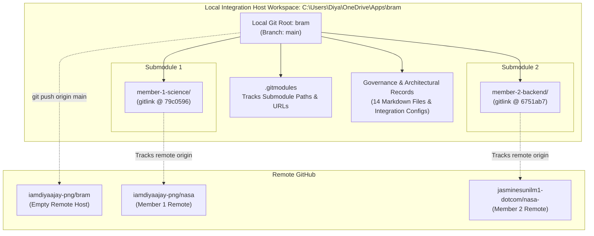

# BHRAMANASTHRA — PHASE 2: INTEGRATION HOST SETUP REPORT
## Remote Inspection & Repository Host Initialization Architecture

**Date:** 15 November 2026  
**Integration Host Workspace:** `C:\Users\Diya\OneDrive\Apps\bram`  
**Remote Integration Repository:** `https://github.com/iamdiyaajay-png/bram`  
**Governance Conformance:** DEC-01 (APPROVED), DEC-02 (APPROVED), DEC-03 (APPROVED), DEC-04 (APPROVED), DEC-05 (BLOCKED), DEC-06 (DEFERRED)  
**Status:** **INSPECTION & HOST DESIGN COMPLETE — AWAITING INITIALIZATION AUTHORIZATION**

---

## 1. Executive Summary

This report establishes the pre-execution inspection and architectural host design for initializing the integration wrapper repository for **Bhramanashthra** (`bram`).

Key Findings:
1. **GitHub Remote (`iamdiyaajay-png/bram`):** Authoritative GitHub API inspection confirms the remote repository is **completely empty** (0 commits, 0 files, 0 branches, size 0 KB). There are zero remote files or commit histories to overwrite, and **zero divergence or history conflicts**.
2. **Local Integration Workspace (`bram`):** Currently uninitialized (`.git` does not exist at root). Contains two fully functional sub-repositories (`member-1-science` and `member-2-backend`), along with 13 comprehensive architecture, ADR, approval, and audit markdown documents, plus the Phase 1 packaging configuration.
3. **Child Submodules Preservation:** `member-1-science` (pinned at commit `79c0596`) and `member-2-backend` (pinned at commit `6751ab7`) will be integrated as native **Git Submodules**, preserving 100% of their independent Git histories, branches, and remote origins without history flattening or tree collision.
4. **Adjacent Workspace Safety:** The adjacent original workspace `C:\Users\Diya\OneDrive\Apps\nasa` has been verified as untouched and completely isolated.
5. **No Force Push:** Because the remote is empty, the initial push will be a standard clean fast-forward push (`git push -u origin main`). Zero force pushes or destructive Git operations are required.

---

## 2. Remote Repository Inspection Details

Inspection was conducted via the GitHub REST API (`https://api.github.com/repos/iamdiyaajay-png/bram`) and `git ls-remote`:

| Attribute | Inspected Remote Value | Verification Assessment |
| :--- | :--- | :--- |
| **Repository Name** | `bram` | Confirmed |
| **Full Identifier** | `iamdiyaajay-png/bram` | Confirmed authoritative owner |
| **Default Branch** | `main` | Configured default branch |
| **Repository Size** | `0 KB` | Empty repository |
| **Commit History** | `0 Commits` (API `/commits` returned HTTP 409 Conflict: Empty Repo) | Confirmed zero existing commits |
| **Remote References** | `0 Refs` (`git ls-remote` returned exit code 0 with empty stdout) | Confirmed zero branches or tags |
| **Existing Files** | None (Tree is uninitialized) | Confirmed zero file collisions |
| **Conflict Potential** | **NONE** | Clean slate initialization |

---

## 3. Local Workspace Git Inspection

Inspection of `C:\Users\Diya\OneDrive\Apps\bram` confirms the following local structure:

### 3.1 Root Integration Host
- **Git Status:** Uninitialized (`Test-Path .git` $\to$ `False`).
- **Phase 1 Validation:** 
  - Member 1 test suite: **94 / 94 Passed** (0.038s).
  - Member 2 test suite: **91 / 91 Passed** (8.878s, 100% data isolation).
  - Standalone `pyproj` coordinate transformation: Verified ($dx = 0$, $dy = 2.33 \times 10^{-10}$ m).

### 3.2 Member 1 (`member-1-science`)
- **Filesystem Location:** [member-1-science/](file:///c:/Users/Diya/OneDrive/Apps/bram/member-1-science)
- **Git Repository:** Present (`member-1-science/.git` $\to$ `True`).
- **Active Branch:** `main` (synchronized with `origin/main`).
- **Head Commit:** `79c0596831f77c7d1ff4666ad71833e562d7bcc9` (`docs(status): update status milestone and commit hash in project brain`).
- **Remote Origin:** `https://github.com/iamdiyaajay-png/nasa.git`.
- **Working Tree:** Tracked files clean; 1 untracked packaging manifest ([pyproject.toml](file:///c:/Users/Diya/OneDrive/Apps/bram/member-1-science/pyproject.toml)) from Phase 1.
- **Commit History:** Complete 5-commit history intact back to initial commit `70954c9`.

### 3.3 Member 2 (`member-2-backend`)
- **Filesystem Location:** [member-2-backend/](file:///c:/Users/Diya/OneDrive/Apps/bram/member-2-backend)
- **Git Repository:** Present (`member-2-backend/.git` $\to$ `True`).
- **Active Branch:** `main` (synchronized with `origin/main`).
- **Head Commit:** `6751ab779be1451f044bb7ba9c2d1cfa9baeafe0` (`docs: establish official NASA Space Apps 2026 compliance documentation (COMPLIANCE.md)`).
- **Remote Origin:** `https://github.com/jasminesunilm1-dotcom/nasa-.git`.
- **Working Tree:** Clean except 1 unstaged modification ([backend/requirements.txt](file:///c:/Users/Diya/OneDrive/Apps/bram/member-2-backend/backend/requirements.txt) with `pyproj>=3.6.0` added in Phase 1).
- **Commit History:** Complete 3-commit history intact back to initial commit `453aff3`.

### 3.4 Root Documentation Inventory (All Preserved)
The following 14 governance and architectural artifacts reside in the root workspace and will be tracked in the integration host repository:
1. [PRE_INTEGRATION_WORKSPACE_AUDIT.md](file:///c:/Users/Diya/OneDrive/Apps/bram/PRE_INTEGRATION_WORKSPACE_AUDIT.md)
2. [INTEGRATION_COMPATIBILITY_AUDIT.md](file:///c:/Users/Diya/OneDrive/Apps/bram/INTEGRATION_COMPATIBILITY_AUDIT.md)
3. [INTEGRATION_ARCHITECTURE_BLUEPRINT.md](file:///c:/Users/Diya/OneDrive/Apps/bram/INTEGRATION_ARCHITECTURE_BLUEPRINT.md)
4. [INTEGRATION_BLUEPRINT_VERIFICATION.md](file:///c:/Users/Diya/OneDrive/Apps/bram/INTEGRATION_BLUEPRINT_VERIFICATION.md)
5. [PRE_IMPLEMENTATION_DECISION_REVIEW.md](file:///c:/Users/Diya/OneDrive/Apps/bram/PRE_IMPLEMENTATION_DECISION_REVIEW.md)
6. [FINAL_ARCHITECTURE_VALIDATION.md](file:///c:/Users/Diya/OneDrive/Apps/bram/FINAL_ARCHITECTURE_VALIDATION.md)
7. [ARCHITECTURE_DECISION_RECORD.md](file:///c:/Users/Diya/OneDrive/Apps/bram/ARCHITECTURE_DECISION_RECORD.md)
8. [ADR_SCIENTIFIC_CORRECTION_REPORT.md](file:///c:/Users/Diya/OneDrive/Apps/bram/ADR_SCIENTIFIC_CORRECTION_REPORT.md)
9. [ADR_FINAL_SEMANTIC_VERIFICATION.md](file:///c:/Users/Diya/OneDrive/Apps/bram/ADR_FINAL_SEMANTIC_VERIFICATION.md)
10. [ADR_FINAL_THRESHOLD_CORRECTION_REPORT.md](file:///c:/Users/Diya/OneDrive/Apps/bram/ADR_FINAL_THRESHOLD_CORRECTION_REPORT.md)
11. [ADR_FINAL_TWO_POINT_VERIFICATION.md](file:///c:/Users/Diya/OneDrive/Apps/bram/ADR_FINAL_TWO_POINT_VERIFICATION.md)
12. [ARCHITECTURE_APPROVAL_VERIFICATION.md](file:///c:/Users/Diya/OneDrive/Apps/bram/ARCHITECTURE_APPROVAL_VERIFICATION.md)
13. [PHASE_1_PACKAGING_AND_ENVIRONMENT_REPORT.md](file:///c:/Users/Diya/OneDrive/Apps/bram/PHASE_1_PACKAGING_AND_ENVIRONMENT_REPORT.md)
14. [requirements-integration.txt](file:///c:/Users/Diya/OneDrive/Apps/bram/requirements-integration.txt)

---

## 4. Integration Host Architecture Design



### 4.1 Submodule Architecture Strategy
Adopting Git submodules guarantees:
1. **Independent History Preservation:** Neither child repository's Git history is rewritten, squashed, or merged into a foreign tree.
2. **Attribution & Provenance:** Commits in `member-1-science` remain authored by Member 1; commits in `member-2-backend` remain authored by Member 2.
3. **Zero Collision:** Identical relative paths (e.g. `.agents/`, `GEMINI.md`, `INTEGRATION_HANDOFF.md`) remain quarantined within their respective submodule folders.
4. **Deterministic Version Pinning:** The parent integration repository stores precise 160000 gitlinks (`79c0596` and `6751ab7`), ensuring reproducible builds across development and CI/CD environments.

---

## 5. Safest Step-by-Step Initialization Procedure

To initialize the integration host without data loss or remote disruption, the following exact 7-step sequence is designed:

```powershell
# Step 1: Initialize local Git repository on default branch 'main'
git init -b main

# Step 2: Associate remote origin pointing to GitHub bram repository
git remote add origin https://github.com/iamdiyaajay-png/bram.git

# Step 3: Create root .gitignore to protect against caches and temporary files
# Excludes __pycache__, .pytest_cache, *.pyc, outputs/layers, and temporary artifacts

# Step 4: Register existing child repositories as submodules
git submodule add https://github.com/iamdiyaajay-png/nasa.git member-1-science
git submodule add https://github.com/jasminesunilm1-dotcom/nasa-.git member-2-backend

# Step 5: Stage all root architecture, ADR, approval, and Phase 1 reports
git add .gitignore .gitmodules requirements-integration.txt *.md

# Step 6: Commit integration repository foundation
git commit -m "chore(integration): initialize Bhramanashthra integration host with Member 1 & Member 2 submodules"

# Step 7: Push cleanly to empty GitHub remote (standard fast-forward push; NO force push)
git push -u origin main
```

---

## 6. Safeguards & Invariant Verification

- [x] **Remote/Local Conflict Check:** Verified remote is empty; 0 commits, 0 refs. Zero merge conflicts possible.
- [x] **No Force Push:** Standard `git push -u origin main` will be used; zero force options.
- [x] **Member 1 & 2 History Preserved:** Complete Git commit logs remain intact in `member-1-science/.git` and `member-2-backend/.git`.
- [x] **Audit & ADR Documents Preserved:** All 14 root files intact and designated for version-controlled tracking in the host repo.
- [x] **Zero Application Code Modification:** No edits to `tracker.py`, `pipeline.py`, backend routes, or algorithms.
- [x] **Science Adapter Deferred:** `science_adapter.py` will not be started until Phase 2 adapter execution.
- [x] **Adjacent Workspace Protected:** `C:\Users\Diya\OneDrive\Apps\nasa` remains completely untouched.

---

## 7. Exact Next Action

**Exact Next Action:** Execute the 7-step initialization procedure on workspace `C:\Users\Diya\OneDrive\Apps\bram`:
1. Run `git init -b main` in `C:\Users\Diya\OneDrive\Apps\bram`.
2. Configure remote `origin` to `https://github.com/iamdiyaajay-png/bram.git`.
3. Create root `.gitignore`.
4. Register `member-1-science` and `member-2-backend` as native Git submodules.
5. Stage all architectural and audit markdown files.
6. Create the initial integration commit.
7. Push the `main` branch to GitHub.

